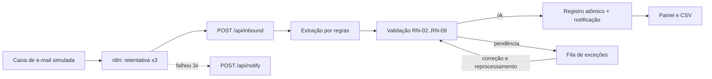

# Fluxo: automação de pedidos recebidos por e-mail

Estudo de caso de automação de ponta a ponta, feito por **João Gabriel Maia da Costa** (Engenharia de Software, PUC Minas) para um portfólio.

> **Tudo aqui é fictício.** A "Distribuidora Santa Clara", as pessoas, os clientes, os produtos, os CNPJs e os telefones foram inventados. As reuniões e entrevistas são **simuladas**: o Claude interpretou o cliente. **Não existe cliente real, operação real nem produção.** Não há deploy nem link de hospedagem; tudo roda local.

## O que o Fluxo faz

Recebe pedidos que chegam por e-mail (tabela, texto livre ou PDF), extrai os dados, valida as regras de negócio, registra no banco, avisa a equipe e alimenta um painel. O que precisa de decisão humana cai numa **fila de exceções**, com o motivo em linguagem de negócio e um formulário de correção e reprocessamento.

O que eu quis mostrar não é só a automação, e sim o processo **antes e depois**, a medição **honesta** e o que acontece **quando algo dá errado**.



O n8n orquestra a entrada (retentativa e alerta); as regras ficam em código tipado, com teste unitário (ADR-001). O pipeline também funciona sem o n8n, chamando `/api/inbound` direto.

## Rodar localmente

Requisitos: Node 22, Docker.

```bash
cp .env.example .env            # valores de exemplo, só para uso local
docker compose up -d db         # Postgres na porta 5436
npm install
npm run db:migrate && npm run db:seed
npm run dev                     # http://localhost:3100
```

Opcional: `docker compose up -d n8n` e o passo a passo em [`docs/04-processo/n8n-como-rodar.md`](docs/04-processo/n8n-como-rodar.md).

| Comando | Para quê |
|---|---|
| `npm test` | unitários e integração (banco separado `fluxo_test`) |
| `npm run test:e2e` | ponta a ponta no navegador (precisa de `npm run build`) |
| `npm run load` | teste de carga com 500 mensagens |
| `npm run export:csv` | CSVs para Power BI |

## Resultados (execuções reais, 23/10/2026)

| O quê | Resultado |
|---|---|
| Unitários e integração | 76 de 76 passaram |
| Ponta a ponta | 5 de 5 passaram |
| Fluxo n8n | pedido registrado, reenvio ignorado e alerta após 3 tentativas, observados no n8n 2.44.6 |
| Carga (500 mensagens) | 500 de 500 com a decisão esperada; mediana 95 ms e p95 152 ms por requisição |

A primeira execução da carga **achou um defeito real** (deadlock sob concorrência, 5 pedidos em falha) que corrigi; mantive as duas execuções em `docs/04-processo/`. Detalhes e o que **não** foi verificado: [`docs/05-qualidade`](docs/05-qualidade/01-resultados-de-testes.md).

**Sobre o ganho de tempo:** é uma **estimativa** com fórmula e entradas visíveis (cenário base: 211,2 h/mês liberadas com 80 pedidos/dia, 8 min manuais, 20% de revisão e 4 min por exceção). Não é resultado medido e eu não afirmo "reduziu X%". Veja o [relatório de medição](docs/04-processo/relatorio-de-medicao.md).

## Limites assumidos

- Extração por regras determinísticas; o modo com LLM é opcional e não foi executado neste registro.
- Notificação simulada (grava no banco); não prova entrega real.
- A caixa de e-mail é um webhook; o gatilho IMAP real não foi testado.
- O alerta de falha passa pelo próprio app, então não cobre o app fora do ar.
- Sem relatório de Power BI publicado; apenas os CSVs.
- Sem prints de tela no repositório por enquanto.

## Roteiro de leitura (7 passos)

1. [Sobre este caso](docs/00-sobre-este-caso/README.md)
2. [Regras de negócio](docs/02-definicao/02-regras-de-negocio.md)
3. [Processo TO-BE](docs/02-definicao/07-processo-to-be.md)
4. [Decisões de arquitetura](docs/03-arquitetura/ADRs.md)
5. [Rastreabilidade](docs/02-definicao/06-rastreabilidade.md)
6. [Resultados de testes](docs/05-qualidade/01-resultados-de-testes.md)
7. [Relatório de medição](docs/04-processo/relatorio-de-medicao.md)

Índice completo: [`docs/INDEX.md`](docs/INDEX.md).

## Estrutura

```
src/lib/extraction/   provedores de extração (regras, LLM opcional, determinístico de teste)
src/lib/validation.ts regras de negócio (RN-xx)
src/lib/pipeline.ts   ingestão → extração → validação → registro → notificação
src/lib/notify/       adaptador de notificação
automations/          fluxo n8n exportado
docs/                 descoberta, definição, arquitetura, processo, qualidade
```

## Licença

MIT, em [`LICENSE`](LICENSE).
