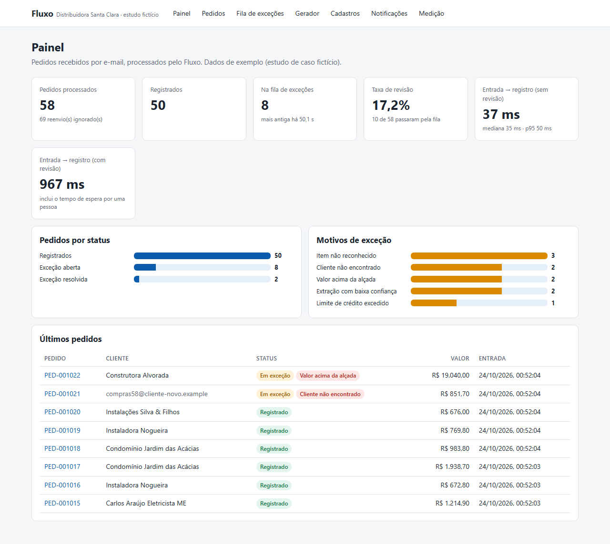
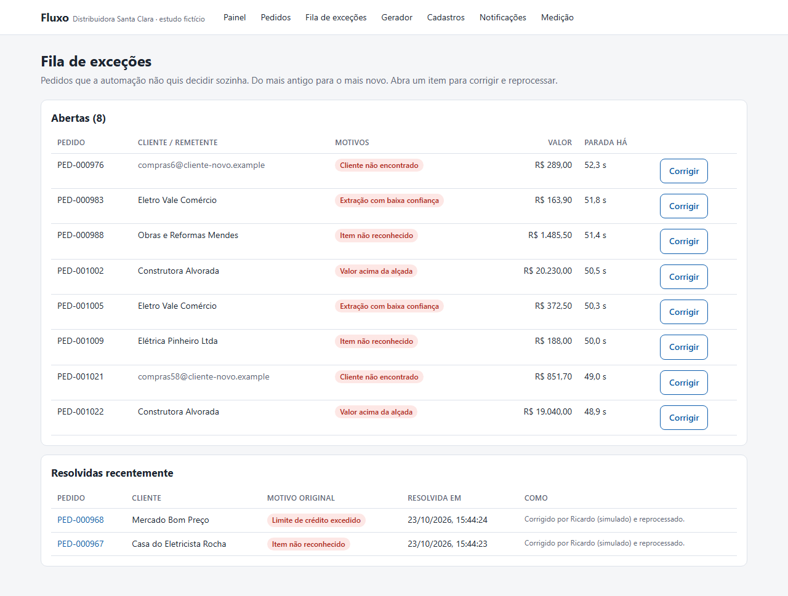
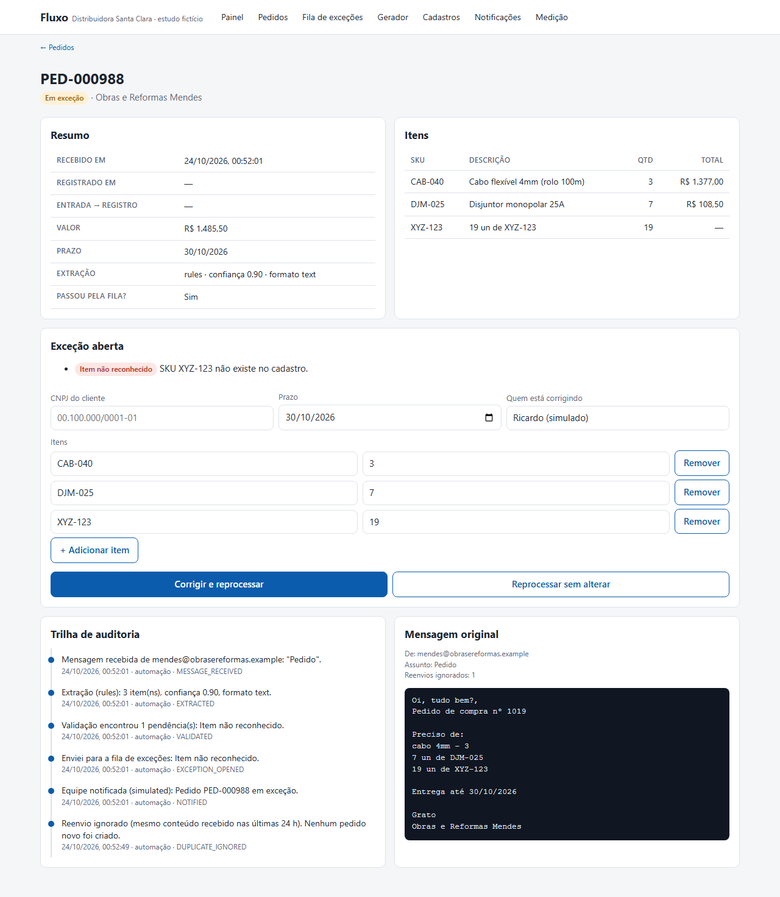
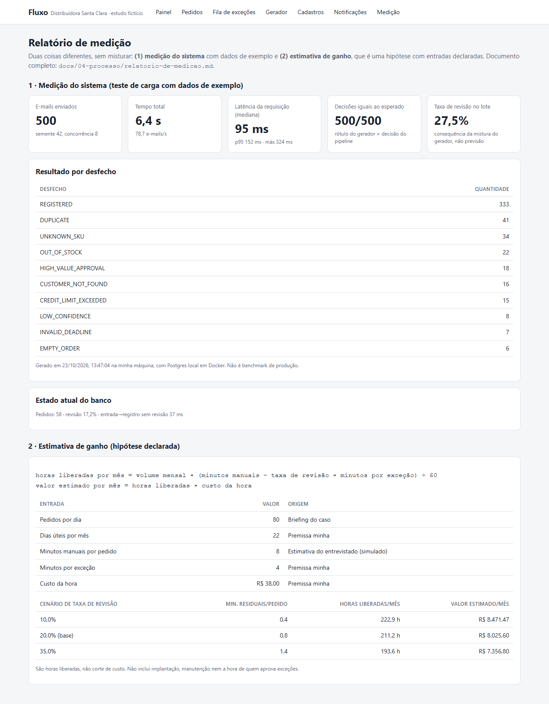
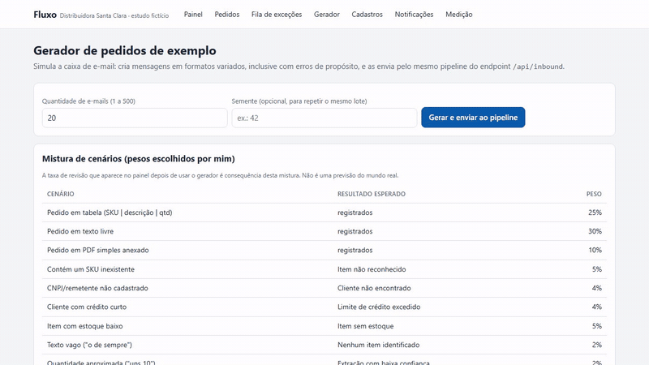
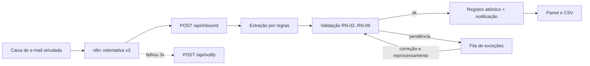

# Fluxo

Pedidos recebidos por e-mail viram registros validados ou exceções explicadas: extração, regras de negócio, fila de exceções com correção e aprovação, auditoria e CSV para Power BI.

**Em 30 segundos**

- **Problema:** numa distribuidora de 15 pessoas, cerca de 80 pedidos por dia chegam por e-mail e cada um é lançado à mão; código de produto trocado, limite de crédito esquecido e pedido duplicado são erros comuns ([o negócio](docs/01-discovery/02-negocio.md)).
- **Solução:** o Fluxo lê o e-mail, extrai os dados, aplica as regras e registra o pedido; o que gera dúvida vai para uma fila com o motivo escrito, onde uma pessoa corrige ou aprova.
- **Prova:** 500 de 500 mensagens processadas, p95 de 152,1 ms, 41 duplicadas barradas, com um deadlock achado e corrigido no caminho ([dados da medição](docs/04-processo/medicao-resultados.json), [relatório](docs/04-processo/relatorio-de-medicao.md)).
- **Comece por aqui:** [fila de exceções](docs/screenshots/04-fila-de-excecoes.png) · [relatório de medição](docs/04-processo/relatorio-de-medicao.md) · [ADR-003, idempotência por Message-ID](docs/03-arquitetura/ADRs.md#adr-003--idempotência-pelo-identificador-da-mensagem)

## Ficha técnica

| | |
|---|---|
| Natureza | Caso fictício; empresa, pessoas e dados inventados |
| Discovery | Três reuniões simuladas, marcadas nas atas |
| Stack | Next.js, TypeScript, Prisma, PostgreSQL, n8n 2.44.6, Docker Compose |
| Extração | Por regras; LLM opcional atrás de `ExtractionProvider`, não executado |
| Notificação | Simulada (adaptador de webhook disponível) |
| Testes | typecheck sem erros; 76 de 76 unitários e de integração; 5 de 5 E2E (24/10/2026, commit `0afe5f7`, [logs](docs/05-qualidade/README.md)) |
| Execução | Local; não hospedado |

Termos e siglas: [glossário](docs/GLOSSARIO.md).

## Duas entradas

**Pelo lado do negócio**

- [Episódio 1, Discovery](docs/01-discovery/README.md): oportunidades, o dia de quem lança pedidos e três reuniões simuladas.
- [Episódio 2, Definição](docs/02-definicao/README.md): regras de negócio, processo futuro (TO-BE) e hipóteses de ganho.
- [Episódio 6, Pós-lançamento](docs/06-pos-lancamento/README.md): exportação de seis CSVs para Power BI.

**Pelo lado técnico**

- [Episódio 3, Arquitetura](docs/03-arquitetura/README.md): sete decisões de arquitetura.
- [Episódio 4, Processo](docs/04-processo/README.md): fluxo no n8n e relatório de medição.
- [Episódio 5, Qualidade](docs/05-qualidade/README.md): resultados de testes, o que não foi verificado e logs.

## Telas

Dados de demonstração gerados pelo gerador do produto. Galeria completa em [`docs/screenshots`](docs/screenshots/README.md).

<table>
<tr>
<td><a href="docs/screenshots/01-painel.png"></a><br><sub>Painel</sub></td>
<td><a href="docs/screenshots/04-fila-de-excecoes.png"></a><br><sub>Fila de exceções</sub></td>
</tr>
<tr>
<td><a href="docs/screenshots/03-detalhe-pedido-com-excecao.png"></a><br><sub>Detalhe com correção</sub></td>
<td><a href="docs/screenshots/09-medicao.png"></a><br><sub>Medição</sub></td>
</tr>
</table>



Demonstração real, 16 s: o gerador cria um lote, um pedido com item inexistente vai para a fila de exceções, o SKU é corrigido e o pedido é registrado.

## O problema

No pico da manhã, de 3 a 5 e-mails de pedido chegam por minuto em alguns intervalos. Cada um é lido, o cliente e os códigos são procurados em planilhas, estoque e crédito são conferidos em outras duas, e o pedido é digitado. O assistente de vendas simulado estima 8 minutos por pedido ([AS-IS](docs/01-discovery/06-processo-atual-as-is.md)).

## O que faz



- Recebe pedidos em tabela, texto livre ou PDF simples e ignora reenvios.
- Valida as regras de negócio (RN, cada uma com código de exceção) e registra o que passa, reservando estoque e crédito numa só transação.
- Envia o que precisa de decisão para a fila de exceções, com correção, reprocessamento e aprovação com justificativa.
- Guarda a trilha de auditoria, mostra um painel e exporta seis CSVs para Power BI.

O n8n orquestra a entrada; as regras ficam em código tipado, com teste unitário ([ADR-001](docs/03-arquitetura/ADRs.md#adr-001--n8n-ou-código-puro)). O pipeline também funciona sem o n8n, chamando `/api/inbound` direto.

## O que este projeto mostra

- Extração por regras, com LLM opcional atrás de uma interface ([ADR-004](docs/03-arquitetura/ADRs.md#adr-004--extração-por-regra-ou-por-llm)).
- Fila de exceções com aprovação auditada ([ADR-005](docs/03-arquitetura/ADRs.md#adr-005--como-tratar-exceções), [ADR-006](docs/03-arquitetura/ADRs.md#adr-006--auditoria)).
- Medição de carga que revelou um deadlock, corrigido e medido de novo ([relatório](docs/04-processo/relatorio-de-medicao.md)).

| O que o projeto exercita | Onde está a prova |
|---|---|
| Mapear o processo e medir antes de automatizar | [AS-IS e método de medição](docs/01-discovery/06-processo-atual-as-is.md); [matriz de oportunidades, nota 4,35](docs/01-discovery/01-oportunidades.md) |
| Escrever regra de negócio com código de exceção | [RN-01 a RN-13](docs/02-definicao/02-regras-de-negocio.md) |
| Orquestrar com n8n e retentativa | [n8n: como rodar](docs/04-processo/n8n-como-rodar.md); [fluxo exportado](automations/fluxo-recebimento-de-pedidos.json) |
| Tratar exceção com aprovação humana e auditoria | [ADR-005](docs/03-arquitetura/ADRs.md#adr-005--como-tratar-exceções), [ADR-006](docs/03-arquitetura/ADRs.md#adr-006--auditoria), capturas da [fila](docs/screenshots/04-fila-de-excecoes.png) e da [aprovação](docs/screenshots/06-aprovacao-humana.png) |
| Medir carga e corrigir defeito | [Relatório de medição](docs/04-processo/relatorio-de-medicao.md): primeira execução 491 de 500, execução final 500 de 500, correção no commit `2f2ef7b` |
| Estimar ganho com fórmula visível (estimativa) | [Relatório de medição](docs/04-processo/relatorio-de-medicao.md) e [TO-BE](docs/02-definicao/07-processo-to-be.md) |
| Entregar dados para BI | [Exportação CSV](docs/06-pos-lancamento/power-bi.md): 6 CSVs |

## Episódios

| Episódio | O que tem |
|---|---|
| [0 · Sobre este caso](docs/00-sobre-este-caso/README.md) | O que é real e o que é simulado |
| [1 · Discovery](docs/01-discovery/README.md) | Matriz de oportunidades, negócio, três reuniões e AS-IS |
| [2 · Definição](docs/02-definicao/README.md) | Requisitos, regras, histórias, riscos, rastreabilidade e TO-BE |
| [3 · Arquitetura](docs/03-arquitetura/README.md) | Sete ADRs |
| [4 · Processo](docs/04-processo/README.md) | n8n e medição de carga |
| [5 · Qualidade](docs/05-qualidade/README.md) | Testes, limites e logs |
| [6 · Pós-lançamento](docs/06-pos-lancamento/README.md) | CSV para Power BI |

Trilhas de 2, 10 e 30 minutos em [`docs/INDEX.md`](docs/INDEX.md).

## Decisões que contam

- [ADR-002](docs/03-arquitetura/ADRs.md#adr-002--onde-fica-cada-regra): a validação é uma função pura e o banco é a rede de segurança.
- [ADR-003](docs/03-arquitetura/ADRs.md#adr-003--idempotência-pelo-identificador-da-mensagem): idempotência pelo Message-ID, com fallback por hash do conteúdo.
- [ADR-005](docs/03-arquitetura/ADRs.md#adr-005--como-tratar-exceções): exceção vai para uma fila e a correção sempre revalida.

**Decisão difícil: n8n ou código puro?** ([ADR-001](docs/03-arquitetura/ADRs.md#adr-001--n8n-ou-código-puro))

| | |
|---|---|
| Contexto | Orquestração visível e regras de negócio testáveis. |
| Alternativas | Tudo no n8n; tudo em código, sem n8n; híbrido, com o n8n orquestrando e o código com as regras. |
| Escolha | Híbrido. |
| Custo aceito | Duas peças para operar; o pipeline também roda sem o n8n, e a entrada fica duplicada, o que permite testar tudo sem ele. |
| Quando mudaria | Com equipe não técnica e regras que mudam toda semana, mais regras iriam para o n8n com uma tabela de configuração; com milhares de mensagens por minuto, o n8n daria lugar a uma fila e workers. |

Outra decisão registrada: na [reunião 1](docs/01-discovery/03-reuniao-gerente-comercial.md), a alçada de R$ 15.000 virou a regra RN-07 e muda o escopo (todo pedido acima disso vai para aprovação humana).

## Evidências

Execuções reais, registradas em arquivo:

- **Carga de 500 mensagens** (23/10/2026, semente 42, concorrência 8): 500 de 500 com a decisão esperada, p95 de 152,1 ms, 41 duplicadas barradas, taxa de revisão de 27,5% ([dados](docs/04-processo/medicao-resultados.json)).
- **Deadlock:** a primeira execução acertou 491 de 500, com 5 pedidos em `PROCESSING_FAILED`; a correção está no commit `2f2ef7b` ([primeira execução](docs/04-processo/medicao-resultados-run1.json)).
- **Testes** (24/10/2026, commit `0afe5f7`): 76 de 76 unitários e de integração, 5 de 5 E2E ([typecheck](docs/05-qualidade/execucao-typecheck-0afe5f7.txt), [testes](docs/05-qualidade/execucao-test-0afe5f7.txt), [E2E](docs/05-qualidade/execucao-test-e2e-0afe5f7.txt)).
- **n8n 2.44.6:** 3 cenários observados (pedido registrado, reenvio ignorado, alerta após 3 tentativas), em [resultados de testes](docs/05-qualidade/01-resultados-de-testes.md).

**Ganho de tempo, só como estimativa:** no cenário base (80 pedidos por dia, 22 dias úteis, 8 min manuais, 20% de revisão, 4 min por exceção), a conta dá 211,2 horas liberadas por mês. É hipótese com fórmula e entradas visíveis no [relatório de medição](docs/04-processo/relatorio-de-medicao.md), não resultado medido.

## Rodar localmente

Requisitos: Node 22 ou superior (os logs de 24/10/2026 usaram Node 24.14.0) e Docker.

```bash
cp .env.example .env            # valores de exemplo, só para uso local
docker compose up -d db         # Postgres na porta 5436
npm install
npm run db:migrate && npm run db:seed
npm run dev                     # http://localhost:3100
```

Opcional: `docker compose up -d n8n` e o passo a passo em [`docs/04-processo/n8n-como-rodar.md`](docs/04-processo/n8n-como-rodar.md).

| Comando | Para quê |
|---|---|
| `npm test` | unitários e integração (banco separado `fluxo_test`) |
| `npm run test:e2e` | ponta a ponta no navegador (precisa de `npm run build`) |
| `npm run load` | carga com 500 mensagens; sobrescreve `docs/04-processo/medicao-resultados.json` |
| `npm run screenshots` | refaz as capturas de `docs/screenshots` (app no ar) |

Os CSVs saem por `GET /api/export/<nome>.csv`, como descrito em [`power-bi.md`](docs/06-pos-lancamento/power-bi.md).

## O que falta para sair do estudo

- Leitura de e-mail (IMAP) real e extração por LLM não foram verificadas ([resultados de testes](docs/05-qualidade/01-resultados-de-testes.md)).
- Acessibilidade não foi verificada ([resultados de testes](docs/05-qualidade/01-resultados-de-testes.md)).
- Não existe relatório de Power BI, só os CSVs ([Exportação CSV](docs/06-pos-lancamento/power-bi.md)).
- O alerta de exceção parada (RF-16, RN-13, HU-14) é planejado e não tem código ([rastreabilidade](docs/02-definicao/06-rastreabilidade.md)).
- A carga foi medida só em ambiente local ([relatório de medição](docs/04-processo/relatorio-de-medicao.md)).
- Não há hospedagem; tudo roda local ([sobre este caso](docs/00-sobre-este-caso/README.md)).

## Limites

- A notificação é simulada: grava no banco e não prova entrega real.
- O alerta de falha passa pelo próprio app, então não cobre o app fora do ar.
- A caixa de e-mail é um webhook; o gatilho IMAP não foi testado.
- Os números de carga vêm de um gerador cuja mistura de erros eu defini; não preveem uma operação real.

## Licença

MIT, em [`LICENSE`](LICENSE).
