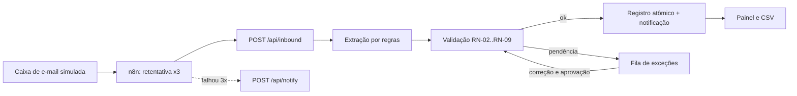

# Fluxo

Pedidos recebidos por e-mail viram registros validados ou exceções explicadas: extração por regras, regras de negócio, fila de exceções com correção e aprovação, auditoria e CSV para Power BI.

**Neste README:** [problema](#o-problema) · [demonstração](#demonstração) · [funcionalidades](#o-que-construí) · [ciclo de vida](#ciclo-de-vida-do-discovery-à-evolução) · [competência e prova](#competência--evidência) · [decisão difícil](#decisão-difícil) · [evidências](#evidências) · [limites](#limites) · [documentos](#documentos-complementares)

## O problema

Cenário: uma distribuidora de materiais elétricos recebe cerca de 80 pedidos por dia por e-mail, e cada um é lançado à mão. Código de produto trocado, limite de crédito esquecido e pedido duplicado são os erros comuns.

O assistente de vendas do caso estima 8 minutos por pedido ([AS-IS](docs/01-discovery/06-processo-atual-as-is.md)). Os tempos vêm de personagem simulado, não de medição.

**Solução e valor.** O Fluxo lê o e-mail, extrai os dados, aplica as regras e registra o pedido. O que gera dúvida vai para uma fila com o motivo escrito, onde uma pessoa corrige ou aprova. A gerência ganha painel e trilha de decisão; quem lança deixa de conferir planilhas; o cliente pode reenviar o e-mail sem duplicar o pedido ([visão e discovery](docs/ciclo-de-vida/01-visao-e-discovery.md)).

## Demonstração

<table>
<tr>
<td> Painel</td>
<td> Fila de exceções</td>
</tr>
<tr>
<td> Detalhe com correção</td>
<td> Medição</td>
</tr>
</table>

Demonstração real, 16 s, com dados do gerador do produto. Galeria completa, incluindo o canvas do n8n, em [`docs/screenshots`](docs/screenshots/README.md).

## Ficha técnica

| | |
|---|---|
| Natureza | Estudo de caso fictício |
| Stack | Next.js, TypeScript, Prisma, PostgreSQL, n8n 2.44.6 |
| Testes | 80 de 80 unitários e de integração e 5 de 5 E2E, com lint, typecheck e build sem erros, em 24/10/2026, commit `09f1d18` ([logs](docs/05-qualidade/README.md)) |

Termos e siglas: [glossário](docs/GLOSSARIO.md).

## O que construí

- Implementei a extração por regras, com LLM opcional atrás de `ExtractionProvider` (`src/lib/extraction/`, [ADR-004](docs/03-arquitetura/ADRs.md#adr-004--extração-por-regra-ou-por-llm)).
- Escrevi a validação como função pura, com as regras RN-01 a RN-13 e um código de exceção por regra (`src/lib/validation.ts`, [regras de negócio](docs/02-definicao/02-regras-de-negocio.md)).
- Construí a idempotência por Message-ID com fallback por hash, apoiada em UNIQUE no banco ([ADR-003](docs/03-arquitetura/ADRs.md#adr-003--idempotência-pelo-identificador-da-mensagem)).
- Montei a fila de exceções com correção e aprovação humana, e uma auditoria em tabela que o código só alimenta com inserções ([ADR-005](docs/03-arquitetura/ADRs.md#adr-005--como-tratar-exceções), [ADR-006](docs/03-arquitetura/ADRs.md#adr-006--auditoria)).
- Isolei a notificação num adaptador, simulado ou por webhook ([ADR-007](docs/03-arquitetura/ADRs.md#adr-007--notificação-com-adaptador-trocável)), e exportei seis CSVs para Power BI ([exportação](docs/06-pos-lancamento/power-bi.md)).
- Medi uma carga de 500 mensagens, que revelou dois defeitos; corrigi, medi de novo e acrescentei teste de regressão ([testes e qualidade](docs/ciclo-de-vida/07-testes-e-qualidade.md#o-defeito-que-a-carga-achou)).

## Ciclo de vida: do discovery à evolução

| Fase | O que mostra | Documento |
|---|---|---|
| Discovery | Visão, partes interessadas, RACI, escopo, AS-IS e TO-BE com atores, decisões e aprovações | [Visão e discovery](docs/ciclo-de-vida/01-visao-e-discovery.md) |
| Planejamento | Backlog priorizado, release plan, seis sprints, definição de pronto e de feito | [Planejamento e Scrum](docs/ciclo-de-vida/02-planejamento-e-scrum.md) |
| Requisitos | Matriz RN-01 a RN-13 até o teste, critérios de aceite, registro de mudanças | [Requisitos e rastreabilidade](docs/ciclo-de-vida/03-requisitos-e-rastreabilidade.md) |
| Arquitetura | C4, componentes, sequências, estados, ADRs e requisitos de qualidade | [Arquitetura e ADRs](docs/ciclo-de-vida/04-arquitetura-e-adrs.md) |
| Dados | ER, dicionário, restrições, idempotência e transações | [Modelo de dados](docs/ciclo-de-vida/05-modelo-de-dados.md) |
| Desenvolvimento | Branches, commits, versões, ambientes, segredos e histórico | [Desenvolvimento e configuração](docs/ciclo-de-vida/06-desenvolvimento-e-configuracao.md) |
| Qualidade | Estratégia, casos, defeitos com causa raiz e regressão | [Testes e qualidade](docs/ciclo-de-vida/07-testes-e-qualidade.md) |
| Implantação | O que existe, plano de rollout e rollback, adoção e monitoramento | [Implantação e operação](docs/ciclo-de-vida/08-implantacao-e-operacao.md) |
| Evolução | Dívida técnica priorizada, roadmap e lições aprendidas | [Evolução e roadmap](docs/ciclo-de-vida/09-evolucao-e-roadmap.md) |

### Linha do tempo e sprints

Os commits reais estão em 23 e 24/10/2026. As janelas de sprint abaixo são planejamento do cenário e não correspondem a datas de commit.

| Sprint | Objetivo | Janela do cenário | Registro no Git |
|---|---|---|---|
| [S1](docs/ciclo-de-vida/sprints/sprint-1-mapeamento-e-requisitos.md) | Mapear o processo e fixar escopo e regras | 14–18/09/2026 | `bea867c`, `9b15ba3` |
| [S2](docs/ciclo-de-vida/sprints/sprint-2-regras-e-extracao.md) | Regras, extração e idempotência | 21–25/09/2026 | `55b7464` |
| [S3](docs/ciclo-de-vida/sprints/sprint-3-excecoes-aprovacao-e-auditoria.md) | Exceções, aprovação e auditoria | 28/09–02/10/2026 | `2f2ef7b` |
| [S4](docs/ciclo-de-vida/sprints/sprint-4-orquestracao-n8n.md) | Orquestração no n8n | 05–09/10/2026 | `d5c832b`, `57d8f16`, `dfb83b4` |
| [S5](docs/ciclo-de-vida/sprints/sprint-5-concorrencia-e-carga.md) | Carga e correção do deadlock | 12–16/10/2026 | `2f2ef7b`, `7415a84` |
| [S6](docs/ciclo-de-vida/sprints/sprint-6-integracao-analitica-e-evidencias.md) | CSV para BI e evidências | 19–23/10/2026 | `2f2ef7b`, `dfb83b4`, `7415a84` |

### Reuniões e decisões com o cliente

| Reunião | Decisão que mudou o projeto |
|---|---|
| [Kickoff](docs/ciclo-de-vida/reunioes/00-kickoff-e-brainstorm.md) | "Pedidos por e-mail" escolhido pela matriz de oportunidades (nota 4,35) |
| [Gerência comercial](docs/01-discovery/03-reuniao-gerente-comercial.md) | Alçada de R$ 15.000 vira a regra RN-07; painel em vez de e-mail |
| [Quem lança os pedidos](docs/01-discovery/04-reuniao-lancador-de-pedidos.md) | ERP fechado fora do escopo; crédito estourado vira exceção aprovável (RN-05) |
| [Cliente-tipo](docs/01-discovery/05-reuniao-cliente-tipo.md) | Idempotência sobe para Must (RN-10) |

### Requisitos e rastreabilidade

Cada regra tem origem, história, implementação e teste. Trecho da [matriz completa](docs/ciclo-de-vida/03-requisitos-e-rastreabilidade.md#matriz-das-regras-de-negócio-rn-01-a-rn-13):

| Regra | Código de exceção | Origem | Implementação | Teste |
|---|---|---|---|---|
| RN-05 crédito | `CREDIT_LIMIT_EXCEEDED` | Reuniões 1 e 2 | `src/lib/validation.ts` | `validation.test.ts`, `pipeline.test.ts`, E2E |
| RN-07 alçada R$ 15.000 | `HIGH_VALUE_APPROVAL` | Reunião 1 | `src/lib/validation.ts` | `validation.test.ts`, `pipeline.test.ts` |
| RN-10 idempotência | duplicata registrada | Reunião 3 | `pipeline.ts`, UNIQUE em `messageId` | `pipeline.test.ts`, E2E |
| RN-11 registro atômico | — | Engenharia | `pipeline.ts` | `pipeline.test.ts`, `concurrency.test.ts` |
| RN-13 exceção parada | — | Reunião 1 | planejado (v1.1) | sem teste |

### Arquitetura, dados e gestão de configuração

- **Arquitetura:** n8n orquestra e o código decide; a aplicação Next.js expõe interface e API sobre uma biblioteca de domínio e o PostgreSQL ([C4 e sequências](docs/ciclo-de-vida/04-arquitetura-e-adrs.md)).
- **Dados:** oito tabelas, UNIQUE por Message-ID, CHECK de estoque e crédito, transação no registro ([ER e dicionário](docs/ciclo-de-vida/05-modelo-de-dados.md)).
- **Configuração:** Conventional Commits com IDs de requisito, PRs com merge commit, sem tags e sem workflow de CI; as verificações são locais e arquivadas ([configuração](docs/ciclo-de-vida/06-desenvolvimento-e-configuracao.md)).

## Competência → evidência

| O que o projeto exercita | Onde está a prova |
|---|---|
| Mapear o processo e medir antes de automatizar | [AS-IS e método de medição](docs/01-discovery/06-processo-atual-as-is.md); [matriz de oportunidades, nota 4,35](docs/01-discovery/01-oportunidades.md) |
| Levantar necessidades com o cliente | [Reuniões](docs/ciclo-de-vida/reunioes/README.md) e [registro de mudanças](docs/ciclo-de-vida/03-requisitos-e-rastreabilidade.md#registro-de-mudanças) |
| Escrever regra de negócio com código de exceção | [RN-01 a RN-13](docs/02-definicao/02-regras-de-negocio.md) e [matriz de rastreabilidade](docs/ciclo-de-vida/03-requisitos-e-rastreabilidade.md) |
| Planejar e conduzir com Scrum | [Backlog, release plan e sprints](docs/ciclo-de-vida/02-planejamento-e-scrum.md) |
| Orquestrar com n8n e retentativa | [fluxo no n8n](docs/04-processo/n8n-como-rodar.md); [fluxo exportado](automations/fluxo-recebimento-de-pedidos.json); [canvas](docs/screenshots/11-n8n-canvas.png) |
| Decidir arquitetura e registrar trade-offs | [7 ADRs](docs/03-arquitetura/ADRs.md) e [arquitetura](docs/ciclo-de-vida/04-arquitetura-e-adrs.md) |
| Modelar dados e garantir consistência | [Modelo de dados](docs/ciclo-de-vida/05-modelo-de-dados.md); [schema](prisma/schema.prisma); [migrations](prisma/migrations/) |
| Tratar exceção com aprovação humana e auditoria | [ADR-005](docs/03-arquitetura/ADRs.md#adr-005--como-tratar-exceções), [ADR-006](docs/03-arquitetura/ADRs.md#adr-006--auditoria), capturas da [fila](docs/screenshots/04-fila-de-excecoes.png) e da [aprovação](docs/screenshots/06-aprovacao-humana.png) |
| Medir carga, achar a causa raiz e corrigir | [Defeitos DEF-01 e DEF-02](docs/ciclo-de-vida/07-testes-e-qualidade.md#o-defeito-que-a-carga-achou); [relatório de medição](docs/04-processo/relatorio-de-medicao.md), commit `2f2ef7b` |
| Estimar ganho com fórmula visível | [Relatório de medição](docs/04-processo/relatorio-de-medicao.md) e [TO-BE](docs/02-definicao/07-processo-to-be.md), como estimativa |
| Gerenciar configuração e evolução | [Desenvolvimento e configuração](docs/ciclo-de-vida/06-desenvolvimento-e-configuracao.md); [dívida técnica e roadmap](docs/ciclo-de-vida/09-evolucao-e-roadmap.md) |
| Planejar implantação, adoção e operação | [Implantação e operação](docs/ciclo-de-vida/08-implantacao-e-operacao.md) |
| Entregar dados para BI | [Exportação CSV](docs/06-pos-lancamento/power-bi.md): 6 CSVs |

## Decisão difícil

**n8n ou código puro?** ([ADR-001](docs/03-arquitetura/ADRs.md#adr-001--n8n-ou-código-puro))

| | |
|---|---|
| Contexto | Orquestração visível e regras de negócio testáveis. |
| Alternativas | Tudo no n8n; tudo em código, sem n8n; híbrido, com o n8n orquestrando e o código com as regras. |
| Escolha | Híbrido. |
| Custo aceito | Duas peças para operar; o pipeline também roda sem o n8n, e a entrada fica duplicada, o que permite testar tudo sem ele. |
| Quando mudaria | Com equipe não técnica e regras que mudam toda semana, mais regras iriam para o n8n com uma tabela de configuração; com milhares de mensagens por minuto, o n8n daria lugar a uma fila e workers. |

Na [reunião 1](docs/01-discovery/03-reuniao-gerente-comercial.md), a alçada de R$ 15.000 virou a regra RN-07 e mudou o escopo: todo pedido acima disso vai para aprovação humana.

## Evidências

- **Carga de 500 mensagens** (23/10/2026, correção no commit `2f2ef7b`): 500 de 500 com a decisão esperada, p50 de 95,4 ms, p95 de 152,1 ms, 41 duplicadas barradas, taxa de revisão de 27,5% ([dados](docs/04-processo/medicao-resultados.json)).
- **Primeira execução:** 491 de 500; das 9 divergências, 5 foram `PROCESSING_FAILED` por deadlock e 4 `UNKNOWN_SKU` por defeito do extrator ([dados](docs/04-processo/medicao-resultados-run1.json), [análise](docs/ciclo-de-vida/07-testes-e-qualidade.md#o-defeito-que-a-carga-achou)).
- **Regressão do deadlock** (24/10/2026): o teste de concorrência falhou em 6 de 6 rodadas com o código anterior à correção e passou em 6 de 6 com o atual.
- **Testes** (24/10/2026, commit `09f1d18`): 80 de 80 unitários e de integração, 5 de 5 E2E ([testes](docs/05-qualidade/execucao-test-09f1d18.txt), [E2E](docs/05-qualidade/execucao-test-e2e-09f1d18.txt), [lint](docs/05-qualidade/execucao-lint-09f1d18.txt), [typecheck](docs/05-qualidade/execucao-typecheck-09f1d18.txt), [build](docs/05-qualidade/execucao-build-09f1d18.txt)).
- **n8n 2.44.6:** 3 cenários observados: pedido registrado, reenvio ignorado e alerta após 3 tentativas ([resultados de testes](docs/05-qualidade/01-resultados-de-testes.md)).
- **Documentação:** 7 [ADRs](docs/03-arquitetura/ADRs.md), 16 [histórias](docs/02-definicao/03-historias-e-moscow.md) (8 Must, 4 Should, 2 Could, 2 Won't), 10 [riscos](docs/02-definicao/05-riscos.md), 14 linhas de [rastreabilidade](docs/02-definicao/06-rastreabilidade.md), 11 capturas e 1 GIF.

Ganho de tempo, só como estimativa: no cenário base (80 pedidos por dia, 22 dias úteis, 8 min manuais, 20% de revisão, 4 min por exceção), a conta dá 211,2 horas por mês. Fórmula e entradas estão no [relatório de medição](docs/04-processo/relatorio-de-medicao.md).

## Limites

- Notificação simulada; leitura de e-mail real (IMAP) e extração por LLM não verificadas ([resultados de testes](docs/05-qualidade/01-resultados-de-testes.md)).
- A interface e as rotas de leitura, exportação, geração e reprocessamento não têm autenticação de usuário; o nome de quem aprova é texto livre.
- A auditoria só recebe inserções por convenção do código; o banco não impede alteração ou exclusão.
- Acessibilidade não testada; não existe relatório de Power BI, só os CSVs.
- O alerta de exceção parada (RF-16, RN-13, HU-14) está planejado, sem código; a carga foi medida só em ambiente local; não há CI configurada.

## Evolução prevista

- Alerta de exceção parada, CI e autenticação (v1.1).
- Importação diária de estoque e crédito, alerta fora do app e auditoria imposta pelo banco (v1.2).
- IMAP e LLM verificados, relatório de Power BI e confirmação por e-mail ao cliente (v2.0). Detalhes e dívida técnica em [Evolução e roadmap](docs/ciclo-de-vida/09-evolucao-e-roadmap.md).

## Documentos complementares

| Documento | Conteúdo |
|---|---|
| [Ciclo de vida](docs/ciclo-de-vida/README.md) | Índice, linha do tempo e nove documentos do discovery à evolução |
| [Sprints](docs/ciclo-de-vida/sprints/README.md) · [Reuniões](docs/ciclo-de-vida/reunioes/README.md) · [Diagramas](docs/ciclo-de-vida/diagramas/README.md) | Planejamento, atas e catálogo de diagramas |
| [Índice da série](docs/INDEX.md) | Seis episódios e trilhas de leitura de 2, 10 e 30 minutos |
| [Galeria de telas](docs/screenshots/README.md) · [Glossário](docs/GLOSSARIO.md) | Capturas legendadas e termos |
| [CHANGELOG](CHANGELOG.md) | Mudanças |

## Nota de contexto acadêmico

Este projeto é um estudo de caso acadêmico, com dados, empresas e atividades de gestão simulados.

A IA generativa (Claude, da Anthropic) foi utilizada como apoio ao desenvolvimento e à documentação. As decisões e os resultados foram revisados pelo autor, e os testes citados seguem as evidências registradas.

## Licença

[MIT](LICENSE).
