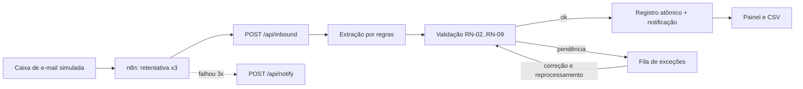

# Fluxo

Pedidos recebidos por e-mail viram registros validados ou exceções explicadas: extração por regras, regras de negócio, fila de exceções com correção e aprovação, auditoria e CSV para Power BI.

## O problema

Cenário: uma distribuidora de materiais elétricos recebe cerca de 80 pedidos por dia por e-mail, e cada um é lançado à mão. Código de produto trocado, limite de crédito esquecido e pedido duplicado são os erros comuns.

O assistente de vendas do caso estima 8 minutos por pedido ([AS-IS](docs/01-discovery/06-processo-atual-as-is.md)). Os tempos vêm de personagem simulado, não de medição.

<table>
<tr>
<td> Painel</td>
<td> Fila de exceções</td>
</tr>
<tr>
<td> Detalhe com correção</td>
<td> Medição</td>
</tr>
</table>

Demonstração real, 16 s, com dados do gerador do produto. Galeria completa em [`docs/screenshots`](docs/screenshots/README.md).

## Ficha técnica

| | |
|---|---|
| Natureza | Estudo de caso fictício |
| Stack | Next.js, TypeScript, Prisma, PostgreSQL, n8n 2.44.6 |
| Testes | 76 de 76 unitários e de integração e 5 de 5 E2E, em 24/10/2026, commit `522bdc7` ([logs](docs/05-qualidade/README.md)) |

Termos e siglas: [glossário](docs/GLOSSARIO.md).

## O que construí

- Implementei a extração por regras, com LLM opcional atrás de `ExtractionProvider` (`src/lib/extraction/`, [ADR-004](docs/03-arquitetura/ADRs.md#adr-004--extração-por-regra-ou-por-llm)).
- Escrevi a validação como função pura, com as regras RN-01 a RN-13 e um código de exceção por regra (`src/lib/validation.ts`, [regras de negócio](docs/02-definicao/02-regras-de-negocio.md)).
- Construí a idempotência por Message-ID com fallback por hash, apoiada em UNIQUE no banco ([ADR-003](docs/03-arquitetura/ADRs.md#adr-003--idempotência-pelo-identificador-da-mensagem)).
- Montei a fila de exceções com correção e aprovação humana, e uma auditoria em tabela que só recebe inserções ([ADR-005](docs/03-arquitetura/ADRs.md#adr-005--como-tratar-exceções), [ADR-006](docs/03-arquitetura/ADRs.md#adr-006--auditoria)).
- Isolei a notificação num adaptador, simulado ou por webhook ([ADR-007](docs/03-arquitetura/ADRs.md#adr-007--notificação-com-adaptador-trocável)), e exportei seis CSVs para Power BI ([exportação](docs/06-pos-lancamento/power-bi.md)).
- Medi uma carga de 500 mensagens, que revelou um deadlock; corrigi e medi de novo ([relatório de medição](docs/04-processo/relatorio-de-medicao.md)).

## Competência → prova

| O que o projeto exercita | Onde está a prova |
|---|---|
| Mapear o processo e medir antes de automatizar | [AS-IS e método de medição](docs/01-discovery/06-processo-atual-as-is.md); [matriz de oportunidades, nota 4,35](docs/01-discovery/01-oportunidades.md) |
| Escrever regra de negócio com código de exceção | [RN-01 a RN-13](docs/02-definicao/02-regras-de-negocio.md) |
| Orquestrar com n8n e retentativa | [fluxo no n8n](docs/04-processo/n8n-como-rodar.md); [fluxo exportado](automations/fluxo-recebimento-de-pedidos.json) |
| Tratar exceção com aprovação humana e auditoria | [ADR-005](docs/03-arquitetura/ADRs.md#adr-005--como-tratar-exceções), [ADR-006](docs/03-arquitetura/ADRs.md#adr-006--auditoria), capturas da [fila](docs/screenshots/04-fila-de-excecoes.png) e da [aprovação](docs/screenshots/06-aprovacao-humana.png) |
| Medir carga e corrigir defeito | [Relatório de medição](docs/04-processo/relatorio-de-medicao.md): primeira execução 491 de 500, final 500 de 500, correção no commit `2f2ef7b` |
| Estimar ganho com fórmula visível | [Relatório de medição](docs/04-processo/relatorio-de-medicao.md) e [TO-BE](docs/02-definicao/07-processo-to-be.md), como estimativa |
| Entregar dados para BI | [Exportação CSV](docs/06-pos-lancamento/power-bi.md): 6 CSVs |

## Decisão difícil

**n8n ou código puro?** ([ADR-001](docs/03-arquitetura/ADRs.md#adr-001--n8n-ou-código-puro))

| | |
|---|---|
| Contexto | Orquestração visível e regras de negócio testáveis. |
| Alternativas | Tudo no n8n; tudo em código, sem n8n; híbrido, com o n8n orquestrando e o código com as regras. |
| Escolha | Híbrido. |
| Custo aceito | Duas peças para operar; o pipeline também roda sem o n8n, e a entrada fica duplicada, o que permite testar tudo sem ele. |
| Quando mudaria | Com equipe não técnica e regras que mudam toda semana, mais regras iriam para o n8n com uma tabela de configuração; com milhares de mensagens por minuto, o n8n daria lugar a uma fila e workers. |

Na [reunião 1](docs/01-discovery/03-reuniao-gerente-comercial.md), a alçada de R$ 15.000 virou a regra RN-07 e mudou o escopo: todo pedido acima disso vai para aprovação humana.

## Evidências

- **Carga de 500 mensagens** (23/10/2026, correção no commit `2f2ef7b`): 500 de 500 com a decisão esperada, p50 de 95,4 ms, p95 de 152,1 ms, 41 duplicadas barradas, taxa de revisão de 27,5% ([dados](docs/04-processo/medicao-resultados.json)).
- **Deadlock:** a primeira execução acertou 491 de 500, com 5 pedidos em `PROCESSING_FAILED` ([primeira execução](docs/04-processo/medicao-resultados-run1.json)).
- **Testes** (24/10/2026, commit `522bdc7`): 76 de 76 unitários e de integração, 5 de 5 E2E ([testes](docs/05-qualidade/execucao-test-522bdc7.txt), [E2E](docs/05-qualidade/execucao-test-e2e-522bdc7.txt)).
- **n8n 2.44.6:** 3 cenários observados: pedido registrado, reenvio ignorado e alerta após 3 tentativas ([resultados de testes](docs/05-qualidade/01-resultados-de-testes.md)).
- **Documentação:** 7 [ADRs](docs/03-arquitetura/ADRs.md), 16 [histórias](docs/02-definicao/03-historias-e-moscow.md) (8 Must, 4 Should, 2 Could, 2 Won't), 10 [riscos](docs/02-definicao/05-riscos.md) e 14 linhas de [rastreabilidade](docs/02-definicao/06-rastreabilidade.md).
- **Imagens:** 11 capturas e 1 GIF em [`docs/screenshots`](docs/screenshots/README.md), incluindo o canvas do fluxo no n8n.

Trilhas de leitura de 2, 10 e 30 minutos em [`docs/INDEX.md`](docs/INDEX.md).

Ganho de tempo, só como estimativa: no cenário base (80 pedidos por dia, 22 dias úteis, 8 min manuais, 20% de revisão, 4 min por exceção), a conta dá 211,2 horas por mês. Fórmula e entradas estão no [relatório de medição](docs/04-processo/relatorio-de-medicao.md).

## Limites

- Notificação simulada; leitura de e-mail real (IMAP) e extração por LLM não verificadas ([resultados de testes](docs/05-qualidade/01-resultados-de-testes.md)).
- Acessibilidade não testada.
- Não existe relatório de Power BI, só os CSVs ([exportação](docs/06-pos-lancamento/power-bi.md)).
- O alerta de exceção parada (RF-16, RN-13, HU-14) está planejado, sem código ([rastreabilidade](docs/02-definicao/06-rastreabilidade.md)).
- A carga foi medida só em ambiente local, com mistura de erros que eu defini; não há CI configurada.

## Evolução prevista

- Alerta de exceção parada (RF-16, RN-13, HU-14).
- Alerta de falha por canal independente do app ([resultados de testes](docs/05-qualidade/01-resultados-de-testes.md)).
- Confirmação por e-mail ao cliente (HU-15, no roadmap).

## Licença

MIT, em [`LICENSE`](LICENSE). O código roda localmente; instruções em [`CONTRIBUTING.md`](CONTRIBUTING.md).
