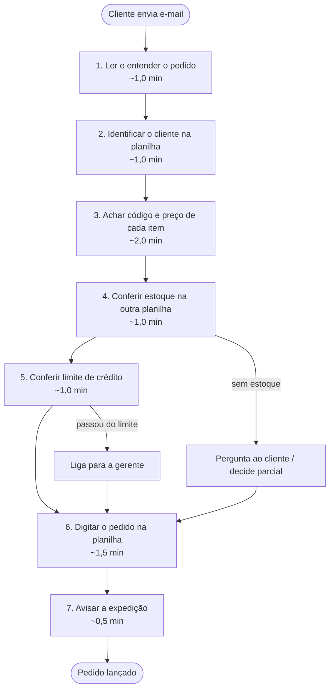

# 06 · Processo atual (AS-IS), gargalos e método de medição

> Reunião simulada; pessoas e empresa fictícias.
> Os tempos abaixo são **estimativas dadas por Ricardo Teixeira** (personagem simulado) na reunião 2. Não são medições. O método para medir de verdade está no fim deste documento.

## Diagrama AS-IS

## Tempos por etapa (estimativa do entrevistado, pedido médio)

| Etapa | Tempo (min) | Onde dói |
|---|---|---|
| 1. Ler e entender | 1,0 | Texto livre e PDF exigem releitura |
| 2. Identificar cliente | 1,0 | CNPJ ausente; nomes parecidos |
| 3. Achar código/preço | 2,0 | **Gargalo 1**: códigos parecidos, planilha de produtos |
| 4. Conferir estoque | 1,0 | **Gargalo 2**: outra planilha, atualizada de manhã |
| 5. Conferir crédito | 1,0 | **Gargalo 3**: depende do saldo exportado |
| 6. Digitar | 1,5 | Erro de digitação |
| 7. Avisar expedição | 0,5 | Interrupção do trabalho |
| **Total** | **8,0** | Pequeno ≈ 4 min; grande ≈ até 20 min |

## Gargalos
1. **Busca de código de produto**: maior parcela do tempo e maior fonte de erro.
2. **Conferências em planilhas separadas** (estoque, crédito): trabalho repetitivo e baseado em regras, ótimo para automação.
3. **Fila de e-mails no pico**: o tempo de espera do cliente cresce com o volume. Não tenho número, só o relato de "acumula".

## Ineficiências fora do tempo de trabalho
- Reenvio de e-mail do cliente → duplicidade.
- Sem registro de quem decidiu o quê (liberação de crédito por telefone fica numa anotação).

## Método de medição (como eu mediria o tempo real)

### Processo manual (antes)
- **Amostra:** 20 pedidos por semana durante 2 semanas, escolhidos por sorteio entre os pedidos do dia (evitar viés de pegar só os fáceis). Estratificar por tamanho: pequeno (1–3 itens), médio (4–10), grande (11+).
- **Instrumento:** cronômetro simples (planilha com início/fim por etapa preenchida pelo próprio atendente, ou observação com cronômetro por mim).
- **Métricas:** tempo por etapa, tempo total por pedido, taxa de pedidos com retrabalho (corrigidos depois do lançamento), tempo entre chegada do e-mail e lançamento.
- **Cuidados:** o simples fato de medir muda o ritmo (efeito de observação). Descartar a primeira semana como aquecimento ou comparar com os dados passivos do carimbo de hora do e-mail e da planilha.
- **Saída:** mediana e percentis 50/90 (média esconde cauda), por estrato.

### Processo automático (depois)
- **Instrumento:** timestamps no banco. `receivedAt` (chegada) e `registeredAt` (registro). Mais os eventos de auditoria.
- **Métricas:** latência de processamento (do recebimento ao registro) em pedidos que passam direto; **taxa de revisão** (pedidos que foram para a fila); tempo de espera na fila (do evento de exceção até a resolução); tempo humano por exceção.
- **Carga:** teste com 500 pedidos de exemplo (ver [relatório de medição](../04-processo/relatorio-de-medicao.md)).
- **Limite honesto:** com dados de exemplo eu meço o **sistema**, não o **ganho no mundo real**. O ganho real exigiria pilotar com pedidos reais.

### Como comparar
`ganho estimado = volume × (tempo manual − tempo humano residual) × custo da hora`, onde o tempo humano residual depende da taxa de revisão. Fórmula e entradas em [07-processo-to-be.md](../02-definicao/07-processo-to-be.md).
