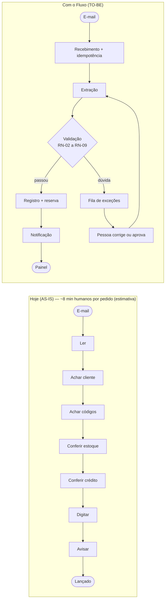

# 07 · Processo futuro (TO-BE), lado a lado com o AS-IS, e hipóteses de ganho

> Simulação: o Claude interpretou o cliente nesta conversa.
> Os números abaixo são **hipóteses** com entradas visíveis. Medições reais do sistema estão no [relatório de medição](../04-processo/relatorio-de-medicao.md).

## AS-IS e TO-BE lado a lado



O que a pessoa deixa de fazer: ler, achar cliente, achar código, conferir estoque e crédito, digitar, avisar. O que continua com a pessoa: decidir as exceções.

## Hipóteses de ganho

### Fórmula
```
minutos_residuais_por_pedido = taxa_de_revisão × minutos_por_exceção
horas_liberadas_por_mês = volume_por_mês × (minutos_manual − minutos_residuais_por_pedido) / 60
valor_estimado_por_mês  = horas_liberadas_por_mês × custo_da_hora
```

### Entradas (todas estimadas; nenhuma é medição)

| Entrada | Valor | Origem |
|---|---|---|
| Volume por dia | 80 pedidos | Briefing do caso |
| Dias úteis por mês | 22 | Premissa minha |
| Volume por mês | 1.760 pedidos (80 × 22) | Cálculo |
| Minutos manual por pedido | 8,0 | Estimativa de Ricardo (simulado) |
| Taxa de revisão | 10% / **20%** / 35% | Cenários meus; Marlene "chuta" 1 em cada 5 |
| Minutos por exceção | 4,0 | Premissa minha (abrir, decidir, corrigir) |
| Custo da hora | R$ 38,00 | Premissa minha, custo total de um assistente |

### Resultado por cenário

| Cenário | Taxa de revisão | Min. residuais/pedido | Horas liberadas/mês | Valor estimado/mês |
|---|---|---|---|---|
| Otimista | 10% | 0,4 | 222,9 h | R$ 8.471,47 |
| **Base** | **20%** | **0,8** | **211,2 h** | **R$ 8.025,60** |
| Conservador | 35% | 1,4 | 193,6 h | R$ 7.356,80 |

Conta do cenário base: `1.760 × (8,0 − 0,8) / 60 = 211,2 h`; `211,2 × 38 = R$ 8.025,60`.

### Como ler esses números
- São **horas liberadas**, não corte de custo. Ninguém é demitido nesta hipótese; o tempo vai para atendimento e tratamento de exceções.
- Não incluem o tempo de implantação, manutenção da automação nem a hora do gerente para aprovações.
- A parte mais frágil é a taxa de revisão: ela só se descobre rodando com pedidos reais. Por isso o sistema mede essa taxa desde o primeiro dia.
- No [relatório de medição](../04-processo/relatorio-de-medicao.md) a taxa de revisão com dados de exemplo é um resultado **da mistura que eu mesmo gerei**, não uma previsão do mundo real.
