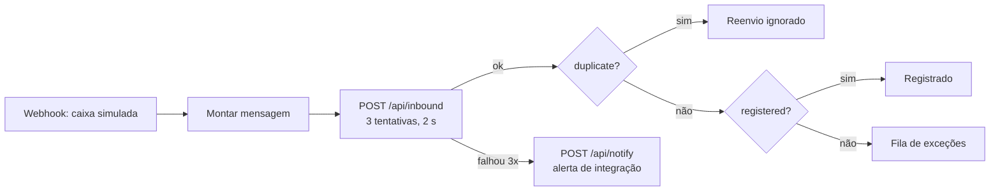

# n8n: como rodar o fluxo de recebimento

Fluxo: `automations/fluxo-recebimento-de-pedidos.json`. Webhook → monta a mensagem → `POST /api/inbound` com 3 tentativas → separa reenvio, registrado e exceção. Se as 3 tentativas falham, chama `POST /api/notify` para avisar a equipe.

## Passo a passo

1. Banco e app: `docker compose up -d db`, `npm run db:migrate && npm run db:seed`, `npm run build && npm run start` (porta 3100).
2. n8n: `docker compose up -d n8n` (porta 5678). A URL e a chave do app chegam por `FLUXO_APP_URL` e `FLUXO_API_KEY`, definidas no `docker-compose.yml`.
3. Importar: `docker compose exec n8n n8n import:workflow --input=/automations/fluxo-recebimento-de-pedidos.json` (no Git Bash do Windows, prefixe com `MSYS_NO_PATHCONV=1`, senão o caminho é reescrito).
4. Ativar: abra `http://localhost:5678`, crie o usuário dono local e ligue o fluxo no editor.
5. Testar: `POST http://localhost:5678/webhook/fluxo/pedido-recebido` com `messageId`, `from`, `subject`, `body`.

## Armadilha que encontrei

Na versão 2.44.6, `n8n publish:workflow` e `update:workflow --active=true` marcam o fluxo como ativo no banco, mas o webhook **não é registrado** depois do reinício (o log diz "0 published workflows" e o webhook responde 404). Ativar pela API interna do editor depois de criar o dono registrou o webhook. Se o fluxo for importado duas vezes, dois fluxos com o mesmo caminho de webhook colidem (erro de unicidade no log); deixe só um ativo.

## Decisão: como alertar a equipe

- **Contexto:** o alerta de falha precisa sair quando o envio ao Fluxo esgota as tentativas.
- **Alternativas:** nó de e-mail do próprio n8n; chamar `/api/notify`.
- **Escolha:** `/api/notify`, que usa o mesmo adaptador de notificação do resto do sistema (ADR-007).
- **Motivo:** um único canal, visível na tela "Notificações" e testável sem credencial externa.
- **Trade-off:** se o app estiver fora do ar, o alerta também não chega.
- **Quando eu mudaria:** em uma operação real, o alerta sairia por um canal independente do app.
