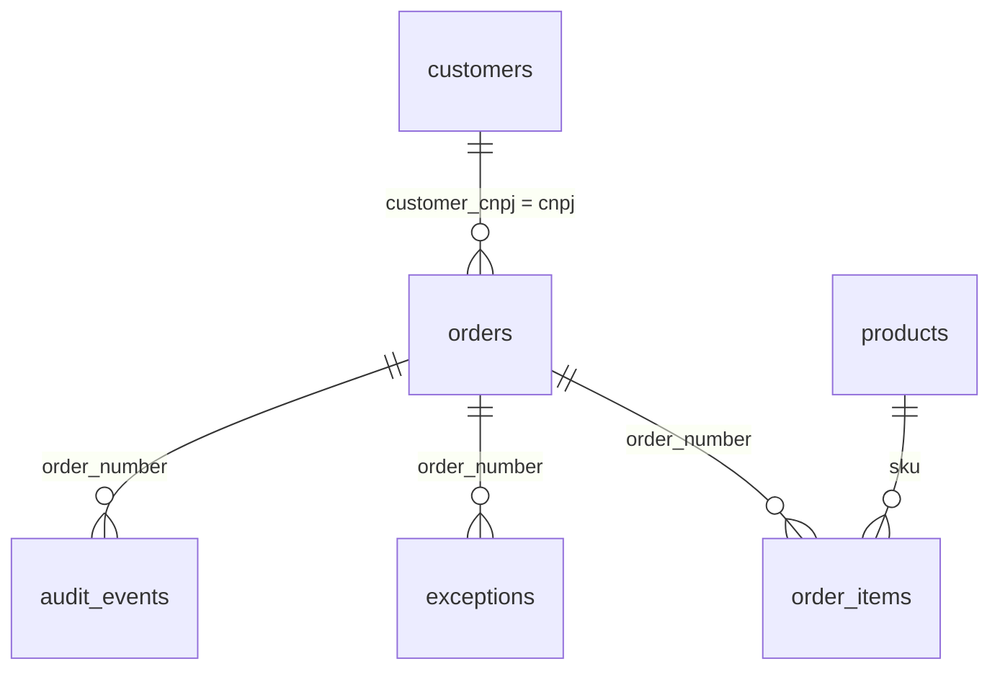

# Exportação CSV para Power BI (RF-15, HU-13)

> Estudo fictício. Esta página documenta os arquivos que o sistema gera. **Não existe relatório de Power BI neste repositório**; só os seis CSVs.

## Como obter

- Pelo app: `GET /api/export/<nome>.csv` (por exemplo `http://localhost:3100/api/export/orders.csv`).
- Pelo terminal, com o app rodando: `curl -o orders.csv http://localhost:3100/api/export/orders.csv`. Os nomes aceitos são `orders`, `order_items`, `exceptions`, `audit_events`, `customers` e `products` (`src/lib/export.ts`).

Codificação UTF-8 com BOM (para o Excel e o Power BI lerem os acentos), separador vírgula, quebra de linha `\r\n`. Datas em ISO 8601 (UTC). Células com vírgula, aspas, ponto e vírgula ou quebra de linha vêm entre aspas.

## Arquivos e colunas

**`orders.csv`** (uma linha por pedido): `order_number`, `status`, `customer_cnpj`, `customer_name`, `received_at`, `registered_at`, `latency_seconds`, `total`, `reviewed`, `deadline`, `deadline_assumed`, `confidence`, `provider`, `primary_exception`.

**`order_items.csv`** (uma linha por item): `order_number`, `sku`, `description`, `quantity`, `unit_price`, `line_total`.

**`exceptions.csv`** (uma linha por motivo de cada exceção): `order_number`, `exception_status`, `reason_code`, `is_primary`, `opened_at`, `resolved_at`, `seconds_to_resolve`.

**`audit_events.csv`**: `at`, `order_number`, `actor`, `actor_name`, `type`, `message`.

**`customers.csv`**: `cnpj`, `name`, `email`, `credit_limit`, `credit_used`, `active`.

**`products.csv`**: `sku`, `name`, `unit`, `price`, `stock`, `active`.

## Relacionamentos sugeridos

## Medidas que o dado permite

- Tempo entre entrada e registro: `latency_seconds` (só existe para pedidos registrados).
- Taxa de revisão: pedidos com `reviewed = true` ÷ total de pedidos.
- Motivos de exceção: contagem de `reason_code` em `exceptions.csv`; use `is_primary` para contar cada pedido uma vez.
- Tempo para resolver uma exceção: `seconds_to_resolve`.

## Limites

- `latency_seconds` mede o processamento dentro do sistema, não o tempo total até a pessoa ver o pedido.
- Os dados são fictícios e vêm do gerador de pedidos; qualquer gráfico feito com eles descreve o gerador, não um negócio.
- Testei apenas que o endpoint devolve o cabeçalho e as linhas (teste E2E). Não abri os arquivos no Power BI.
