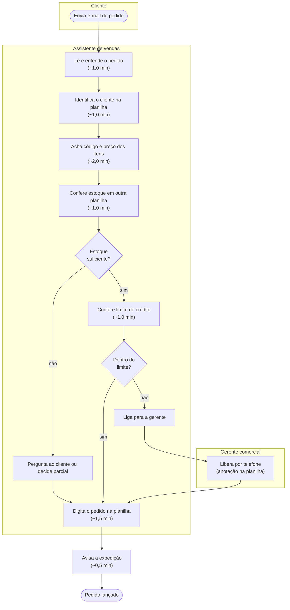
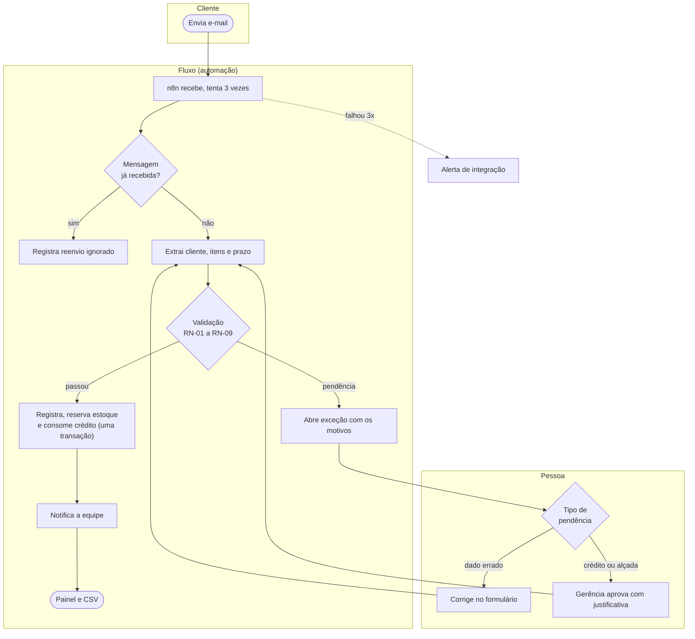

# 1 · Visão e discovery

← [Ciclo de vida](README.md) · [Índice](../INDEX.md) · Próximo: [Planejamento e Scrum](02-planejamento-e-scrum.md)

## Visão do produto

Para uma distribuidora de materiais elétricos que recebe cerca de 80 pedidos por dia por e-mail e os lança à mão, o Fluxo é uma automação que lê o e-mail, extrai os dados, aplica as regras de negócio e registra o pedido. O que gera dúvida vai para uma fila de exceções com o motivo escrito, onde uma pessoa corrige ou aprova. Diferente de um lançamento manual, nada entra errado em silêncio e cada decisão fica registrada.

**Product Goal:** todo pedido que chega por e-mail vira um registro validado ou uma exceção explicada, sem depender de alguém olhando a caixa de entrada.

## O problema

Cenário descrito em [O negócio](../01-discovery/02-negocio.md): a empresa tem 15 pessoas (4 no comercial) e pico de e-mails entre 8h e 10h, de 3 a 5 por minuto em alguns intervalos. Os erros comuns são código de produto trocado, quantidade digitada errada, cliente errado, estoque não conferido, limite de crédito esquecido, pedido duplicado e pedido perdido.

O processo atual leva cerca de 8 minutos por pedido, segundo o assistente de vendas do cenário. É estimativa, não medição.

## Proposta de valor

| Para quem | Valor |
|---|---|
| Gerência comercial | Painel com status, tempo, taxa de revisão e motivos; alçada de R$ 15.000 respeitada; trilha de quem decidiu |
| Quem lança os pedidos | Sai o trabalho de ler, achar cliente e código, conferir estoque e crédito e digitar; fica a decisão sobre as exceções |
| Cliente | Reenviar o e-mail não duplica o pedido; falta de estoque aparece como exceção imediata |

## Partes interessadas

| Papel | Interesse | Como foi ouvido |
|---|---|---|
| Gerente comercial | Pedido errado custa uma viagem; quer saber o que está parado | [Reunião 1](../01-discovery/03-reuniao-gerente-comercial.md) |
| Assistente de vendas | Não quer que o sistema lance errado sem avisar | [Reunião 2](../01-discovery/04-reuniao-lancador-de-pedidos.md) |
| Cliente (instalador) | Saber se o pedido entrou; reenviar sem medo | [Reunião 3](../01-discovery/05-reuniao-cliente-tipo.md) |
| Financeiro | Crédito conferido antes do faturamento; saldo vem de exportação | Citado nas reuniões 1 e 2 |
| TI terceirizada | Mantém o ERP fechado, que não será integrado | Citado na reunião 2 |
| Desenvolvimento | Regras testáveis, medição honesta | Autor do projeto |

### RACI das decisões principais (proposta do cenário)

R = executa, A = responde pela decisão, C = consultado, I = informado.

| Atividade | Gerente comercial | Assistente de vendas | Financeiro | Desenvolvimento |
|---|---|---|---|---|
| Definir alçada e regras de crédito | A | C | C | R |
| Aprovar exceção de valor acima da alçada | A/R | I | I | I |
| Aprovar exceção de crédito | A/R | C | C | I |
| Corrigir dado de pedido na fila | I | A/R | I | I |
| Manter estoque e crédito (exportação diária do ERP) | I | I | A/R | C |
| Manter regras e fluxo | C | C | I | A/R |

## Escopo e fora de escopo

| Dentro | Fora |
|---|---|
| Receber pedido por e-mail (simulado por webhook), em tabela, texto livre ou PDF simples | Integração com ERP real |
| Extração, validação (RN-01 a RN-09), registro atômico, idempotência | Leitura de foto de lista escrita à mão (HU-16) |
| Fila de exceções, correção, aprovação humana, auditoria | Emissão de nota, roteirização, multiempresa |
| Painel, notificação por adaptador, CSV para Power BI | Confirmação por e-mail ao cliente (HU-15, roadmap) |

## Restrições, premissas e dependências

| Tipo | Item | Fonte |
|---|---|---|
| Negócio | Acima de R$ 15.000, sempre aprovação humana | Reunião 1, RN-07 |
| Negócio | Estoque insuficiente nunca é atendido parcialmente pela automação | Reunião 1, RN-06 |
| Técnica | ERP fechado e sem API; estoque e crédito entram por seed ou CSV diário | Reunião 2 |
| Técnica | Sem hospedagem; tudo local | [Sobre este caso](../00-sobre-este-caso/README.md) |
| Premissa | Preço de tabela único, dias úteis sem feriados, moeda em reais sem impostos | [Regras de negócio](../02-definicao/02-regras-de-negocio.md) |
| Dependência | n8n 2.44.6 para o recebimento com retentativa | [n8n](../04-processo/n8n-como-rodar.md) |
| Financeira | Sem orçamento definido no cenário; o ganho é estimativa | [TO-BE](../02-definicao/07-processo-to-be.md) |

Riscos iniciais: [RK-01 a RK-10](../02-definicao/05-riscos.md).

## Critérios de sucesso e indicadores

| Critério | Indicador | Situação |
|---|---|---|
| Pedido correto entra sem toque humano | Decisão do pipeline igual ao rótulo do gerador | 500 de 500 na carga final |
| Nada entra errado em silêncio | Toda dúvida cai na fila com motivo | Coberto por testes de integração e E2E |
| Reenvio não duplica | Um só pedido por mensagem | Coberto por testes (identificador, conteúdo e entregas simultâneas) |
| Gestão enxerga o que está parado | Idade da exceção mais antiga no painel | Implementado; alerta ativo (RF-16) planejado |
| Ganho de tempo | Horas liberadas por mês | Estimativa: 211,2 h no cenário base, com fórmula visível |

## Processo atual (AS-IS)

Atores: cliente, assistente de vendas, gerente comercial, expedição. Pontos de decisão: estoque suficiente? crédito dentro do limite?

Os tempos são estimativas do assistente de vendas do cenário (total de 8,0 min); o detalhe e o método para medir de verdade estão no [AS-IS](../01-discovery/06-processo-atual-as-is.md).

## Processo com o Fluxo (TO-BE)

Pontos de controle: idempotência na entrada, validação das regras, aprovação humana para crédito e alçada, auditoria de cada passo.

O que a pessoa deixa de fazer: ler, achar cliente e código, conferir estoque e crédito, digitar, avisar. O que continua com a pessoa: decidir as exceções. Hipóteses de ganho e fórmula: [TO-BE](../02-definicao/07-processo-to-be.md).

---

**Natureza dos registros.** Reuniões e tempos do AS-IS são do cenário (simulados); a RACI e os critérios de sucesso são artefatos de planejamento; a situação dos indicadores vem de execuções registradas em [Testes e qualidade](07-testes-e-qualidade.md).
