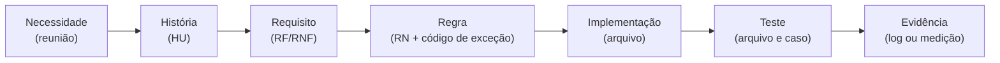

# 3 · Requisitos e rastreabilidade

← [Ciclo de vida](README.md) · [Índice](../INDEX.md) · Anterior: [Planejamento e Scrum](02-planejamento-e-scrum.md) · Próximo: [Arquitetura e ADRs](04-arquitetura-e-adrs.md)

Os requisitos, as regras e as histórias estão em [`docs/02-definicao`](../02-definicao/README.md): 16 RF, 8 RNF, 13 RN e 16 HU. Esta página mostra como as necessidades dos clientes do cenário chegam até o código e o teste.

## Do que o cliente pediu até o teste

Exemplo percorrido: na reunião 1, a gerência pede que tudo acima de R$ 15.000 passe por ela → HU-07 → RF-09 → RN-07 (`HIGH_VALUE_APPROVAL`) → `src/lib/validation.ts` → teste "acima de R$ 15.000 exige aprovação; exatamente R$ 15.000 não" → [log dos testes](../05-qualidade/execucao-test-522bdc7.txt).

## Matriz das regras de negócio (RN-01 a RN-13)

| RN | Regra (resumo) | Código de exceção | Origem | História | Implementação | Testes |
|---|---|---|---|---|---|---|
| RN-01 | Pedido válido: pelo menos um item | `EMPTY_ORDER` | Reunião 2 | HU-03 | `src/lib/validation.ts` | `tests/unit/validation.test.ts` ("sem itens gera EMPTY_ORDER e não LOW_CONFIDENCE") |
| RN-02 | Cliente por CNPJ; sem CNPJ, pelo e-mail do remetente | `CUSTOMER_NOT_FOUND` | Reunião 2 | HU-03 | `src/lib/validation.ts` (`identifyCustomer`) | `validation.test.ts`: 4 casos (e-mail, CNPJ desconhecido, remetente desconhecido, cliente inativo) |
| RN-03 | SKU existente e ativo | `UNKNOWN_SKU` | Reunião 2 | HU-03, HU-05 | `src/lib/validation.ts` | `validation.test.ts` (inexistente, inativo, nulo); `pipeline.test.ts` (vai para a fila sem consumir estoque nem crédito); E2E de fluxo completo |
| RN-04 | Quantidade inteira, de 1 a 5.000 por linha | `INVALID_QUANTITY` | Dia a dia | HU-03 | `src/lib/validation.ts` | `validation.test.ts`: 0, −3, 2,5, 5.001 e nulo inválidos; 1 aceito |
| RN-05 | Crédito usado + total ≤ limite; humano pode aprovar | `CREDIT_LIMIT_EXCEEDED` | Reuniões 1 e 2 | HU-03, HU-07 | `src/lib/validation.ts`; aprovação em `reprocessOrder` (`src/lib/pipeline.ts`) | `validation.test.ts` (excedido; exatamente no limite passa; aprovação libera); `pipeline.test.ts`; E2E de aprovação com justificativa |
| RN-06 | Estoque ≥ pedido, somando linhas do mesmo SKU; sem atendimento parcial | `OUT_OF_STOCK` | Reuniões 1 e 3 | HU-03 | `src/lib/validation.ts` | `validation.test.ts` (soma de linhas; exatamente igual passa); `pipeline.test.ts` (último estoque) |
| RN-07 | Acima de R$ 15.000, aprovação humana | `HIGH_VALUE_APPROVAL` | Reunião 1 | HU-07 | `src/lib/validation.ts` | `validation.test.ts` (exatamente R$ 15.000 não exige); `pipeline.test.ts` (fica na fila até aprovar) |
| RN-08 | Prazo ausente = 2 dias úteis, com registro; data no passado é inválida | `INVALID_DEADLINE` | Reunião 2 | HU-03 | `src/lib/validation.ts`, `src/lib/business-days.ts` | `validation.test.ts` (3 casos); `business-days.test.ts`; `pipeline.test.ts` (prazo assumido na auditoria) |
| RN-09 | Confiança da extração abaixo de 0,70 vai para revisão | `LOW_CONFIDENCE` | Reuniões 1 e 2 | HU-02, HU-05 | `src/lib/validation.ts` | `validation.test.ts` (0,70 exato passa; abaixo gera exceção) |
| RN-10 | Mesma mensagem não gera segundo pedido | duplicata registrada | Reunião 3 | HU-04 | `src/lib/pipeline.ts` (`ingestMessage`) e UNIQUE em `InboundMessage.messageId` | `pipeline.test.ts`: mesmo identificador, mesmo conteúdo com outro identificador, entregas simultâneas; E2E de duplicata |
| RN-11 | Registro, reserva de estoque e crédito numa transação | — | Engenharia | HU-01 | `src/lib/pipeline.ts` (`registerOrder`); CHECK de estoque e crédito no banco | `pipeline.test.ts` (disputa pelo último estoque); `concurrency.test.ts` |
| RN-12 | Até 3 tentativas com espera crescente; esgotadas, vai para a fila | `PROCESSING_FAILED` | Engenharia | HU-10 | `src/lib/retry.ts`, `processMessage` | `retry.test.ts` (5 casos, incluindo deadlock 40P01); `pipeline.test.ts` (falha transitória, permanente, erro de extração, falha na notificação); `concurrency.test.ts` |
| RN-13 | Exceção aberta há mais de N horas gera alerta | — | Reunião 1 | HU-14 | planejado (v1.1); sem código | sem teste |

A linha da RN-13 é um requisito conhecido e ainda não implementado; não aparece como feito em nenhum lugar do repositório.

## Requisitos e onde são verificados

| Requisito | Onde é atendido | Verificação |
|---|---|---|
| RF-01 Receber pedido por endpoint | `src/app/api/inbound` | E2E (chave e formato); `pipeline.test.ts` |
| RF-02 Idempotência | `src/lib/pipeline.ts` | `pipeline.test.ts` |
| RF-03 Extrair de texto livre, tabela e PDF | `src/lib/extraction/`, `src/lib/pdf.ts` | `extraction.test.ts`; `pipeline.test.ts` (texto livre e PDF) |
| RF-04 Validar | `src/lib/validation.ts` | `validation.test.ts` |
| RF-05 Registro atômico | `registerOrder` | `pipeline.test.ts`, `concurrency.test.ts` |
| RF-06 Notificação com adaptador | `src/lib/notify/` | `pipeline.test.ts`; `notify-route.test.ts` |
| RF-07 Fila de exceções | `src/app/exceptions` | `pipeline.test.ts`; E2E |
| RF-08 Corrigir e reprocessar | `reprocessOrder` | `pipeline.test.ts`; E2E |
| RF-09 Aprovação com justificativa | `reprocessOrder` | `pipeline.test.ts`; E2E |
| RF-10 Auditoria | `src/lib/audit.ts` | `pipeline.test.ts` (eventos); E2E (trilha) |
| RF-11 Retentativa | `src/lib/retry.ts` | `retry.test.ts`; `pipeline.test.ts`; 3 cenários do n8n |
| RF-12 Painel | `src/lib/metrics.ts` | `metrics.test.ts` |
| RF-13 Cadastros | `src/app/catalog`, seed | Captura da tela; seed usado por todos os testes de integração |
| RF-14 Gerador | `src/lib/generator.ts` | `generator.test.ts`; usado na carga |
| RF-15 CSV | `src/lib/export.ts` | E2E (cabeçalho e linhas) |
| RF-16 Alerta de exceção parada | planejado (v1.1) | — |
| RNF-01 Desempenho medido | `tests/load/load.ts` | [Relatório de medição](../04-processo/relatorio-de-medicao.md) |
| RNF-02 Persistir antes de processar | `ingestMessage` | `pipeline.test.ts` (falha permanente não perde a mensagem) |
| RNF-03 Auditabilidade | `src/lib/audit.ts` | `pipeline.test.ts`; detalhe do pedido |
| RNF-04 Interfaces para extração, notificação e armazenamento | `ExtractionProvider`, `Notifier` | Provedor determinístico nos testes |
| RNF-05 Regras como funções puras | `src/lib/validation.ts` | `validation.test.ts` sem banco |
| RNF-06 Segurança do endpoint de entrada | chave de API | E2E (401 sem chave); `notify-route.test.ts` |
| RNF-07 Portabilidade (Docker Compose) | `docker-compose.yml` | Parcial: `db` e `n8n` executados; perfil `app` não executado |
| RNF-08 Usabilidade | interface em português | Não verificado (só layout móvel de 390 px) |

## Critérios de aceite dos principais fluxos

| Fluxo | Dado / Quando / Então |
|---|---|
| Pedido válido | Dado um e-mail de cliente cadastrado com itens em estoque e dentro do crédito, quando ele chega, então o pedido fica `REGISTERED` sem intervenção e a equipe é notificada (HU-01) |
| Exceção e correção | Dado um pedido com SKU inexistente, quando ele chega, então vai para a fila com o motivo; quando a pessoa corrige o SKU, então o pedido é revalidado e só vira registrado se passar (HU-05, HU-06) |
| Reenvio | Dado o mesmo e-mail duas vezes, então existe um só pedido e o segundo envio fica registrado como duplicata (HU-04) |
| Aprovação | Dado um pedido acima de R$ 15.000 ou acima do crédito, então só é registrado depois de aprovação com justificativa, que fica na auditoria (HU-07) |

## Registro de mudanças

Mudanças de escopo e de regra decididas nas reuniões e depois, com o impacto no projeto.

| Mudança | Situação | Origem | Impacto |
|---|---|---|---|
| Alçada de R$ 15.000 | Aceita | [Reunião 1](../01-discovery/03-reuniao-gerente-comercial.md) | Nova regra RN-07; HU-07 |
| Estoque insuficiente nunca atendido parcialmente | Aceita | Reunião 1 | RN-06 |
| Crédito estourado como exceção aprovável | Aceita | [Reunião 2](../01-discovery/04-reuniao-lancador-de-pedidos.md) | RN-05, RF-09 (resolve a contradição entre as reuniões 1 e 2) |
| Texto livre e PDF simples | Aceita | Reunião 2 | RF-03 |
| Painel em vez de e-mail como canal de gestão | Aceita | Reunião 1 | RF-12, HU-08 |
| Idempotência sobe para Must | Aceita | [Reunião 3](../01-discovery/05-reuniao-cliente-tipo.md) | RN-10, ADR-003 |
| Integração com ERP | Recusada (ERP fechado) | Reunião 2 | Estoque e crédito por seed ou CSV |
| Foto de lista escrita à mão | Recusada | Reunião 3 | HU-16 (Won't) |
| Confirmação por e-mail ao cliente | Adiada | Reunião 3 | HU-15 (roadmap) |
| Alerta de exceção parada | Adiada para v1.1 | Reunião 1 | RF-16, RN-13, HU-14 |
| Correção do extrator para saudação na mesma linha | Defeito corrigido | Carga e teste manual | `src/lib/extraction/rules.ts`, `2f2ef7b` |

---

**Natureza dos registros.** A matriz e a tabela de verificação vêm do código e dos testes do repositório. As reuniões são do cenário (simuladas). O registro de mudanças organiza decisões já documentadas nas atas.
