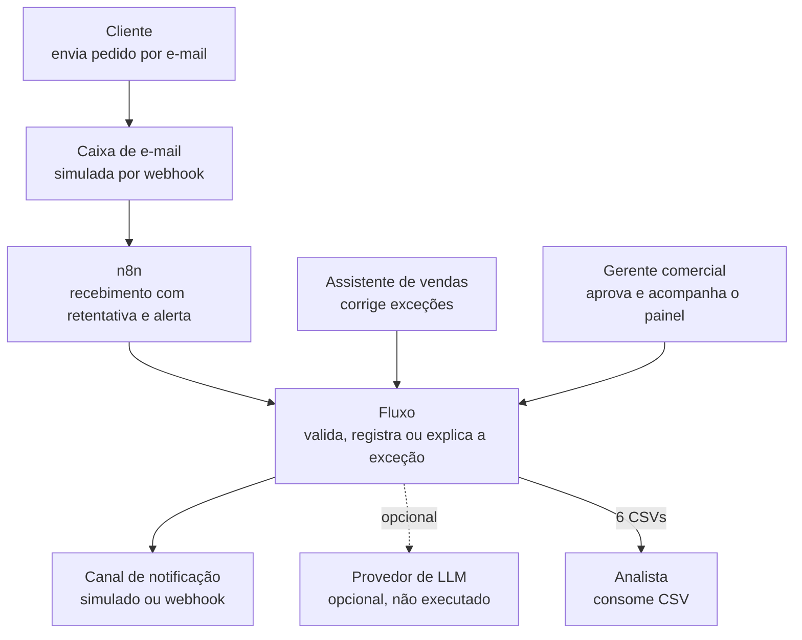
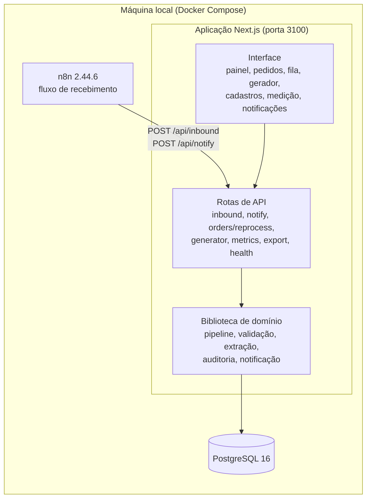
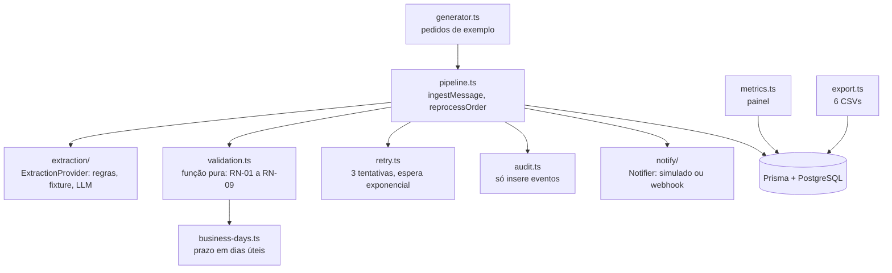
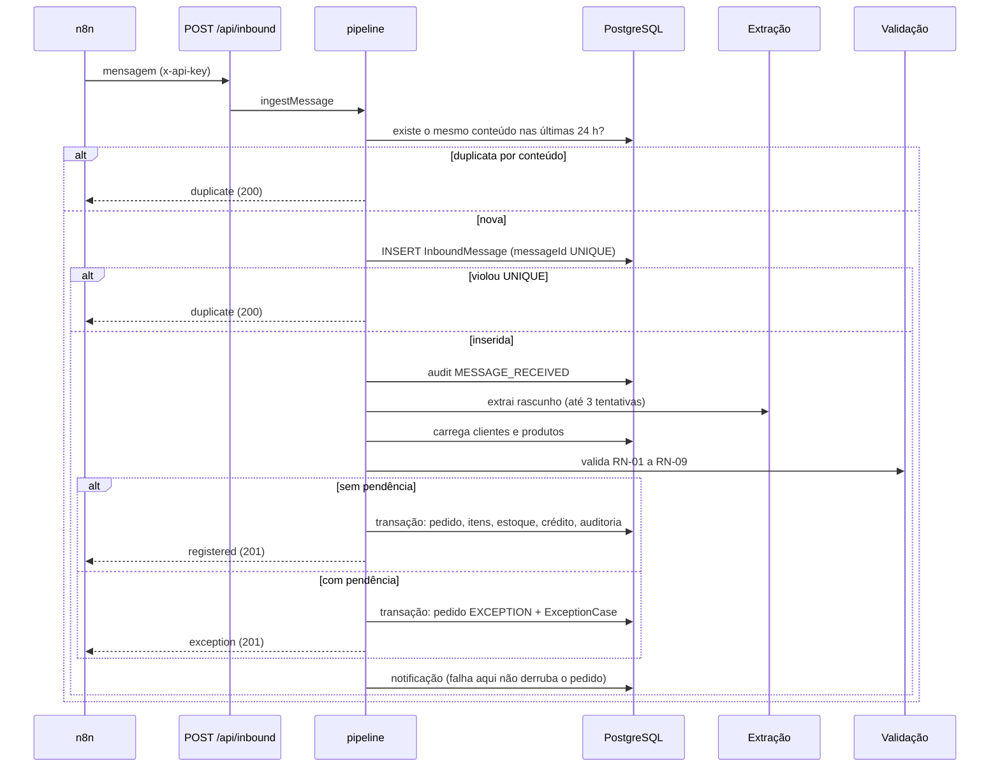
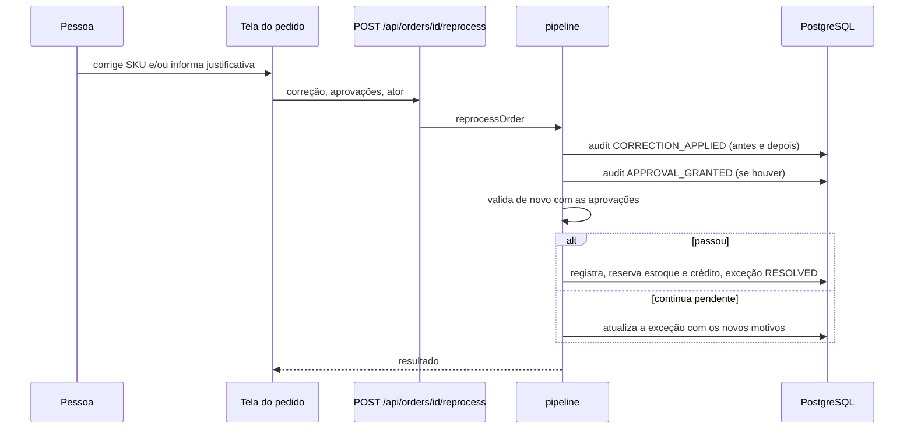
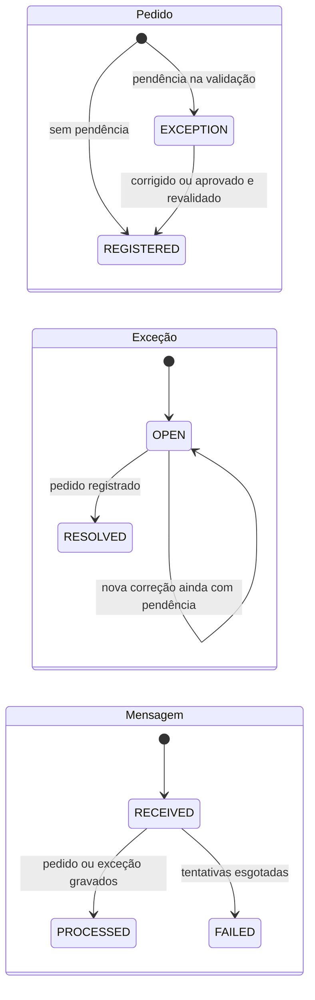

# 4 · Arquitetura e ADRs

← [Ciclo de vida](README.md) · [Índice](../INDEX.md) · Anterior: [Requisitos e rastreabilidade](03-requisitos-e-rastreabilidade.md) · Próximo: [Modelo de dados](05-modelo-de-dados.md)

Os diagramas abaixo representam o código atual da `main`. As decisões completas, com contexto, alternativas, escolha, motivo, trade-off e "quando mudaria", estão em [`ADRs.md`](../03-arquitetura/ADRs.md).

## Contexto (C4, nível 1)

## Contêineres (C4, nível 2)

O n8n e a aplicação são independentes: o pipeline também roda chamando `POST /api/inbound` direto, sem o n8n ([ADR-001](../03-arquitetura/ADRs.md#adr-001--n8n-ou-código-puro)).

## Componentes da biblioteca de domínio

| Componente | Responsabilidade | Dependências |
|---|---|---|
| `pipeline.ts` | Orquestra ingestão, idempotência, extração, validação, registro, exceção, notificação e reprocessamento | extração, validação, retentativa, auditoria, notificação, banco |
| `validation.ts` | Aplica RN-01 a RN-09 sem banco, rede nem relógio | `business-days.ts`, tipos |
| `extraction/` | Interpreta texto, tabela e PDF e devolve rascunho com confiança | PDF simples; LLM só se configurado |
| `retry.ts` | Classifica falha transitória (inclui deadlock 40P01) e repete | — |
| `audit.ts` | Insere eventos com ator, tipo, mensagem e dados | banco |
| `notify/` | Adaptador `Notifier`: grava em tabela ou faz POST em webhook | banco ou HTTP |

## Sequência do fluxo principal: pedido chega

## Sequência: correção e aprovação na fila

## Estados

Um pedido `REGISTERED` não volta a `EXCEPTION`, e o reprocessamento recusa pedido já registrado. `PROCESSING_FAILED` abre uma exceção do mesmo tipo para a pessoa decidir.

## Fluxo de dados e integrações

| Integração | Direção | Protocolo | Autenticação | Situação |
|---|---|---|---|---|
| Caixa de e-mail → n8n | Entrada | Webhook (simulado) | Nenhuma no webhook local | IMAP real não verificado |
| n8n → `/api/inbound` e `/api/notify` | Entrada | HTTP, JSON | Cabeçalho `x-api-key` | Verificado nos 3 cenários |
| Fluxo → canal de notificação | Saída | Tabela ou webhook | — | Só o simulado foi exercitado |
| Fluxo → provedor LLM | Saída | HTTPS | Chave do provedor | Implementado, não executado |
| Fluxo → Power BI | Saída | CSV por HTTP | Nenhuma | Endpoint testado; arquivos não abertos no Power BI |

## Decisões (ADRs)

| ADR | Decisão | Alternativas consideradas | Custo aceito |
|---|---|---|---|
| [001](../03-arquitetura/ADRs.md#adr-001--n8n-ou-código-puro) | Híbrido: n8n orquestra, código tem as regras | Tudo no n8n; tudo em código | Duas peças para operar; entrada duplicada |
| [002](../03-arquitetura/ADRs.md#adr-002--onde-fica-cada-regra) | Validação como função pura, mais restrições no banco | Regra espalhada por camada | Mais código de montagem no pipeline |
| [003](../03-arquitetura/ADRs.md#adr-003--idempotência-pelo-identificador-da-mensagem) | Idempotência por Message-ID com fallback por hash | Deduplicar por regra de negócio; só hash | Falso positivo em reenvio idêntico dentro de 24 h (a nota de revisão do ADR descreve o hash real) |
| [004](../03-arquitetura/ADRs.md#adr-004--extração-por-regra-ou-por-llm) | Regras primeiro; LLM opcional atrás de interface | Só regras; só LLM | Manutenção manual das regras de extração |
| [005](../03-arquitetura/ADRs.md#adr-005--como-tratar-exceções) | Fila de exceções separada; correção sempre revalida | Rejeitar e devolver; flag "revisar" | Mais telas e estados; fila pode ser esquecida |
| [006](../03-arquitetura/ADRs.md#adr-006--auditoria) | Auditoria em tabela de eventos que só recebe inserções | Log de aplicação; colunas "atualizado por" | Crescimento da tabela; a restrição de só inserir é do código, não do banco |
| [007](../03-arquitetura/ADRs.md#adr-007--notificação-com-adaptador-trocável) | Notificação por adaptador (simulado e webhook) | Canal real fixo | O canal simulado não prova entrega real |

## Requisitos de qualidade

| Atributo | Como a arquitetura responde | Limite conhecido |
|---|---|---|
| Segurança | Chave de API em `/api/inbound` e `/api/notify`; sem segredos no repositório (`.env` ignorado) | A interface e as rotas de métricas, exportação, geração e reprocessamento não têm autenticação de usuário; o nome de quem aprova é texto livre |
| Desempenho | Carga de 500 mensagens: p50 de 95,4 ms, p95 de 152,1 ms, 78,7 mensagens/s | Medido só em ambiente local |
| Disponibilidade | Mensagem persistida antes de processar; retentativa; exceção `PROCESSING_FAILED` | Alerta de falha passa pelo próprio app; sem o app no ar, não há alerta |
| Manutenibilidade | Interfaces para extração e notificação; regras puras | Aliases de produto e formatos de extração são manuais |
| Observabilidade | Trilha de auditoria, painel, tela de notificações, tela de medição | Sem logs estruturados nem alertas automáticos |

---

**Natureza dos registros.** Diagramas e tabelas derivam do código (`src/`, `prisma/`, `automations/`) e dos ADRs; resultados de desempenho vêm de [`medicao-resultados.json`](../04-processo/medicao-resultados.json).
