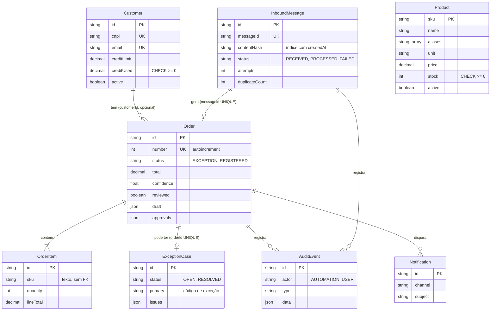

# 5 · Modelo de dados

← [Ciclo de vida](README.md) · [Índice](../INDEX.md) · Anterior: [Arquitetura e ADRs](04-arquitetura-e-adrs.md) · Próximo: [Desenvolvimento e configuração](06-desenvolvimento-e-configuracao.md)

Fonte: [`prisma/schema.prisma`](../../prisma/schema.prisma) e as duas migrations em [`prisma/migrations`](../../prisma/migrations/). O banco é PostgreSQL 16.

## Modelo entidade-relacionamento

`Product` não tem chave estrangeira para `OrderItem`: o SKU do item é texto livre, porque um pedido pode conter SKU inexistente (é a exceção `UNKNOWN_SKU`).

## Dicionário de dados

| Tabela | Colunas principais | Chaves, restrições e índices |
|---|---|---|
| `Customer` | `cnpj`, `name`, `email`, `phone`, `creditLimit` e `creditUsed` (decimal 12,2), `active` | PK `id`; UNIQUE `cnpj` e `email`; CHECK `creditUsed >= 0` e `creditLimit >= 0` |
| `Product` | `sku`, `name`, `aliases` (lista de texto), `unit`, `price` (decimal 10,2), `stock`, `active` | PK `sku`; CHECK `stock >= 0` |
| `InboundMessage` | `messageId`, `contentHash`, `fromEmail`, `subject`, `body`, anexo em base64, `receivedAt`, `status`, `attempts`, `lastError`, `duplicateCount` | PK `id`; UNIQUE `messageId`; índice (`contentHash`, `createdAt`) |
| `Order` | `number`, `status`, `deadline`, `deadlineAssumed`, `total`, `confidence`, `provider`, `receivedAt`, `registeredAt`, `reviewed`, `draft` e `approvals` (JSON) | PK `id`; UNIQUE `number` e `messageId`; FK para `InboundMessage` (RESTRICT) e `Customer` (SET NULL); índices em `status` e `customerId` |
| `OrderItem` | `sku`, `description`, `quantity`, `unitPrice`, `lineTotal` | PK `id`; FK para `Order` (CASCADE) |
| `ExceptionCase` | `status`, `primary`, `issues` (JSON com todos os motivos), `createdAt`, `resolvedAt`, `resolution` | PK `id`; UNIQUE `orderId`; FK para `Order` (CASCADE); índice (`status`, `createdAt`) |
| `AuditEvent` | `at`, `actor`, `actorName`, `type`, `message`, `data` (JSON) | PK `id`; FK opcionais para `Order` e `InboundMessage` (CASCADE); índice (`orderId`, `at`) |
| `Notification` | `at`, `channel`, `recipient`, `subject`, `body` | PK `id`; FK opcional para `Order` (CASCADE) |

Tipos enumerados: `MessageStatus`, `OrderStatus`, `ExceptionStatus`, `Actor` e `ExceptionCode` (os nove códigos das regras RN-01 a RN-09 e `PROCESSING_FAILED`, dez ao todo).

## Idempotência, integridade e transações

| Garantia | Mecanismo | Verificação |
|---|---|---|
| Mesma mensagem não gera segundo pedido | UNIQUE em `InboundMessage.messageId`; o código tenta inserir e trata a violação (P2002) como duplicata, seguro sob concorrência ([ADR-003](../03-arquitetura/ADRs.md#adr-003--idempotência-pelo-identificador-da-mensagem)) | `pipeline.test.ts`: entregas simultâneas do mesmo e-mail resultam em um pedido |
| Mesmo conteúdo com outro identificador | Índice (`contentHash`, `createdAt`) e consulta das últimas 24 h | `pipeline.test.ts` |
| Um pedido por mensagem, uma exceção por pedido | UNIQUE em `Order.messageId` e `ExceptionCase.orderId` | Schema |
| Estoque e crédito nunca negativos | CHECK no banco; `UPDATE` condicional (`stock >= qtd`) dentro da transação | `pipeline.test.ts` (último estoque); `concurrency.test.ts` |
| Registro atômico | `prisma.$transaction`: pedido, itens, reserva de estoque, consumo de crédito, exceção resolvida e auditoria | `pipeline.test.ts` |
| Bloqueios sem deadlock | Reserva de estoque em ordem alfabética de SKU | `concurrency.test.ts` ([defeito e correção](07-testes-e-qualidade.md#o-defeito-que-a-carga-achou)) |

### Fluxo dos dados

1. **Criação:** a mensagem é gravada (`RECEIVED`) antes de qualquer processamento (RNF-02); o evento `MESSAGE_RECEIVED` entra na auditoria.
2. **Processamento:** a transação final cria `Order` e `OrderItem` e, conforme o resultado, baixa estoque e crédito (`REGISTERED`) ou cria `ExceptionCase` (`EXCEPTION`). A mensagem passa a `PROCESSED`, ou a `FAILED` se as tentativas se esgotarem.
3. **Atualização:** a correção altera o rascunho (`Order.draft`) e reavalia; a aprovação grava motivo, autor e hora em `Order.approvals`.
4. **Consulta:** painel e CSV leem do banco; o CSV traz os mesmos códigos de exceção do sistema ([Power BI](../06-pos-lancamento/power-bi.md)).

## Decisões de modelagem

- **Rascunho e motivos em JSON.** `draft`, `approvals` e `issues` guardam estruturas que variam por pedido e são lidas inteiras; a consulta por motivo no painel e no CSV percorre o JSON de `issues`. Em volume maior, os motivos poderiam virar tabela própria, com índice por código.
- **Dinheiro em `Decimal`.** Totais, limites e preços usam decimal, nunca ponto flutuante.
- **Normalização.** Clientes, produtos, mensagens, pedidos, itens, exceções, eventos e notificações são tabelas separadas (3FN nos dados de negócio). A desnormalização está no JSON do rascunho e no `reviewed` do pedido, que evitam reconstruir o histórico a cada leitura.

## Migrations e seeds

| Migration | Conteúdo |
|---|---|
| `20261023162711_init` | Tipos, tabelas, índices e chaves estrangeiras |
| `20261023170000_constraints` | CHECK de estoque e de crédito não negativos |

O seed (`src/lib/seed-data.ts`, `prisma/seed.ts`) cria clientes e produtos fictícios (CNPJs `00.100.000/00NN-NN`, e-mails em `.example`) e, antes disso, apaga os dados transacionais. Os testes de integração usam um banco separado (`fluxo_test`). Os dados de demonstração dos prints vêm do gerador do produto.

## Auditoria, retenção e privacidade

- **Auditoria.** `AuditEvent` só recebe inserções no código da aplicação (`src/lib/audit.ts`). O banco não impõe isso: não há gatilho nem permissão que impeça `UPDATE` ou `DELETE`, e a exclusão de um pedido apaga seus eventos por cascata. É uma limitação registrada em [dívida técnica](09-evolucao-e-roadmap.md#dívida-técnica).
- **Retenção.** Não há política de retenção nem arquivamento implementados; o [ADR-006](../03-arquitetura/ADRs.md#adr-006--auditoria) cita particionar por mês em escala maior.
- **Privacidade.** Todos os dados são fictícios. O corpo e o anexo dos e-mails são guardados em texto; num cenário real, isso exigiria política de retenção e controle de acesso, que não existem aqui.
- **Acesso.** Não há autenticação de usuário na interface; o campo `actorName` guarda o nome informado no formulário.

---

**Natureza dos registros.** Diagrama, dicionário e restrições conferidos contra o schema e as migrations da `main`; as garantias listadas como verificadas apontam para os testes citados.
