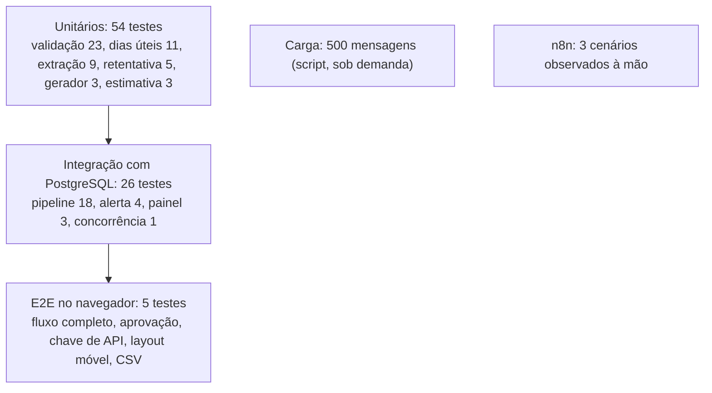

# 7 · Testes e qualidade

← [Ciclo de vida](README.md) · [Índice](../INDEX.md) · Anterior: [Desenvolvimento e configuração](06-desenvolvimento-e-configuracao.md) · Próximo: [Implantação e operação](08-implantacao-e-operacao.md)

## Estratégia

Os testes seguem uma pirâmide: muitos casos rápidos sobre a regra de negócio, menos casos de integração com banco real e poucos fluxos de ponta a ponta. A carga e o fluxo do n8n são verificações separadas, rodadas sob demanda.

| Camada | Arquivos | Comando |
|---|---|---|
| Unitário | `tests/unit/*.test.ts` (6 arquivos) | `npm test` |
| Integração | `tests/integration/*.test.ts` (4 arquivos, banco `fluxo_test`) | `npm test` |
| Ponta a ponta | `tests/e2e/flow.spec.ts` | `npm run test:e2e` |
| Carga | `tests/load/load.ts` | `npm run load` |
| n8n | `automations/fluxo-recebimento-de-pedidos.json`, execução manual | [n8n](../04-processo/n8n-como-rodar.md) |

## Resultados executados

Execução de 24/10/2026, commit `09f1d18`, Node 24.14.0. As saídas completas estão arquivadas.

| Verificação | Resultado | Log |
|---|---|---|
| Lint | Sem avisos nem erros | [lint](../05-qualidade/execucao-lint-09f1d18.txt) |
| Typecheck | Sem erros | [typecheck](../05-qualidade/execucao-typecheck-09f1d18.txt) |
| Unitários e integração | 80 de 80, em 10 arquivos | [testes](../05-qualidade/execucao-test-09f1d18.txt) |
| Build | Concluído (exit 0) | [build](../05-qualidade/execucao-build-09f1d18.txt) |
| E2E | 5 de 5 | [E2E](../05-qualidade/execucao-test-e2e-09f1d18.txt) |

Registros anteriores continuam válidos para os commits que citam: 76 de 76 e 5 de 5 em `0afe5f7` e em `522bdc7`. A diferença para 80 são os 3 testes de painel (`metrics.test.ts`) e o teste de concorrência (`concurrency.test.ts`), acrescentados em 24/10/2026.

## Casos positivos, negativos e de limite

| Tipo | Exemplo | Teste |
|---|---|---|
| Positivo | Pedido válido é registrado, reserva estoque, consome crédito e notifica | `pipeline.test.ts` |
| Positivo | Texto livre "20 disjuntor 20A, 5 rolos de cabo 2,5mm" é extraído e registrado | `pipeline.test.ts`, `extraction.test.ts` |
| Negativo | SKU inexistente vai para a fila e não consome estoque nem crédito | `pipeline.test.ts` |
| Negativo | Correção com SKU ainda inválido mantém o pedido na fila: corrigir não pula validação | `pipeline.test.ts` |
| Negativo | Endpoint de entrada sem chave devolve 401; payload sem remetente válido devolve 400 | E2E; `pipeline.test.ts`; `notify-route.test.ts` |
| Limite | Exatamente R$ 15.000 não exige aprovação; acima exige | `validation.test.ts` |
| Limite | Quantidade 0, −3, 2,5 e 5.001 são inválidas; 1 é aceita | `validation.test.ts` |
| Limite | Confiança de 0,70 passa; abaixo gera `LOW_CONFIDENCE` | `validation.test.ts` |
| Limite | Estoque exatamente igual ao pedido é aceito; linhas repetidas do mesmo SKU são somadas | `validation.test.ts` |
| Limite | Prazo no próprio dia do recebimento é aceito; data inexistente (31/02) é inválida | `validation.test.ts`, `business-days.test.ts` |
| Erro e falha | Falha transitória nas 2 primeiras tentativas registra na 3ª; falha permanente cai na fila como `PROCESSING_FAILED`; falha na notificação não derruba o pedido | `pipeline.test.ts` |
| Concorrência | Duas entregas simultâneas do mesmo e-mail geram um pedido; dois pedidos disputando o último estoque: um registra, o outro vira exceção e o estoque nunca fica negativo | `pipeline.test.ts` |
| Layout | Sem rolagem horizontal em 390 px nas quatro telas principais | E2E |

## O defeito que a carga achou

Evidências: [`medicao-resultados-run1.json`](../04-processo/medicao-resultados-run1.json), [`medicao-resultados.json`](../04-processo/medicao-resultados.json), [relatório de medição](../04-processo/relatorio-de-medicao.md), commit `2f2ef7b`.

| | Execução 1 | Execução final |
|---|---|---|
| Decisões iguais ao rótulo do gerador | 491 de 500 | 500 de 500 |
| `PROCESSING_FAILED` | 5 | 0 |
| Latência da requisição, p95 / máximo | 1010 / 2115 ms | 152,1 / 323,5 ms |
| Tempo total | 10,9 s | 6,4 s |

As 9 divergências da execução 1 tinham duas causas independentes.

### DEF-01 · Deadlock no registro (5 pedidos)

- **Sintoma:** 5 pedidos corretos (1 PDF, 3 tabelas e 1 texto livre, segundo a lista de divergências) terminaram em `PROCESSING_FAILED`; a cauda de latência subiu para 1010 ms no p95.
- **Causa raiz:** o registro baixa o estoque dos SKUs do pedido na ordem em que aparecem na mensagem. Dois pedidos simultâneos com os mesmos SKUs em ordens opostas se travam mutuamente; o PostgreSQL detecta o deadlock (código 40P01) e aborta um deles. Esse erro não era classificado como transitório, então não havia nova tentativa e o pedido caía em `PROCESSING_FAILED`.
- **Correção (`2f2ef7b`):** ordem estável de bloqueio (SKUs em ordem alfabética em `registerOrder`) e classificação de 40P01 e 40001 como falhas transitórias em `retry.ts` (RN-11, RN-12).
- **Validação:** execução final com 0 `PROCESSING_FAILED`; teste unitário da classificação do deadlock (`retry.test.ts`); e, em 24/10/2026, `concurrency.test.ts`, que dispara 40 pedidos simultâneos com `DJM-020` e `CAB-040` em ordens opostas e exige 40 registros, nenhum `PROCESSING_FAILED` e estoque consistente.
- **O teste detecta o defeito?** Com `pipeline.ts` e `retry.ts` restaurados para a versão anterior a `2f2ef7b`, o teste falhou em 6 de 6 rodadas; com o código atual passou em 6 de 6 (24/10/2026, execução local, código restaurado em seguida). Em uma versão anterior do teste, que desligava a retentativa, houve uma falha isolada em 46 execuções com o código corrigido, sem causa determinada; o teste atual usa a retentativa real do sistema.

### DEF-02 · Extrator descartava a linha com saudação (4 pedidos)

- **Sintoma:** 3 pedidos em texto livre que deviam ser registrados e 1 com prazo no passado terminaram em `UNKNOWN_SKU`.
- **Causa raiz:** uma linha como "Bom dia, preciso de 20 disjuntor 20A…" começava com saudação e era tratada como ruído, descartando o pedido inteiro.
- **Correção (`2f2ef7b`):** `GREETING_PREFIX_RE` remove só o prefixo de saudação antes de interpretar a linha (`src/lib/extraction/rules.ts`).
- **Validação:** teste de regressão em `extraction.test.ts`; as contagens fecham entre as duas execuções (`REGISTERED` 325→333, `UNKNOWN_SKU` 38→34, `INVALID_DEADLINE` 6→7).
- **Nota:** a correspondência entre cada uma das 4 divergências e a causa vem do diff, da mensagem do commit e dessas contagens; o repositório não guarda análise caso a caso.

## Registro de defeitos e achados

| ID | Achado | Causa | Situação |
|---|---|---|---|
| DEF-01 | Deadlock sob 8 requisições simultâneas | Ordem de bloqueio de estoque + deadlock não repetido | Corrigido; regressão automatizada |
| DEF-02 | Saudação descartava o pedido | Linha com saudação tratada como ruído | Corrigido; regressão automatizada |
| DEF-03 | E2E falhava após resolver a exceção | O formulário some depois da resolução; as asserções esperavam por ele | Corrigido em `57d8f16` (ajuste do teste ao comportamento do produto) |
| DEF-04 | ADR-003 citava hash com `Date` do e-mail | O código não inclui `Date` e usa janela de 24 h | Nota de revisão no ADR; comportamento mantido |
| DEF-05 | Aviso de ESM carregado como CommonJS no Vitest | `vitest.config.ts` com `import` sem `type=module` | Corrigido (`vitest.config.mts`) |
| DEF-06 | Webhook do n8n 2.44.6 não registra após `publish:workflow` | Comportamento da versão | Documentado; ativação pelo editor |
| ACH-01 | Auditoria só insere por convenção do código | Sem gatilho ou permissão no banco | Aberto, em [dívida técnica](09-evolucao-e-roadmap.md#dívida-técnica) |
| ACH-02 | Interface e rotas de leitura sem autenticação de usuário | Escopo do estudo | Aberto |

## Regressão

Cada correção acima traz um teste: `retry.test.ts` (deadlock como transitório), `extraction.test.ts` (saudação), `concurrency.test.ts` (ordem de bloqueio) e o ajuste do E2E. A suíte inteira roda em cerca de 10 segundos (`npm test`) e o E2E em cerca de 8.

## Segurança, desempenho e acessibilidade

| Tema | O que foi feito | O que não foi |
|---|---|---|
| Segurança | Chave de API testada em `/api/inbound` e `/api/notify` (ausente, errada, não configurada); sem segredos no repositório; GitGuardian nos PRs | Teste de autorização na interface, de injeção ou de limite de tamanho |
| Desempenho | Carga de 500 mensagens com concorrência 8: p50 de 95,4 ms, p95 de 152,1 ms, 78,7 mensagens/s, em ambiente local | Carga contínua, picos maiores ou ambiente de rede real |
| Acessibilidade | Rótulos nos campos de formulário | Auditoria automática (axe) e leitor de tela |
| Usabilidade | Layout móvel de 390 px sem rolagem horizontal | Reunião de aceitação (RNF-08) |

## Cobertura e limites da estratégia

- **Cobertura de código** não foi medida; não há percentual neste relatório.
- **Contrato:** não há testes de contrato; o fluxo do n8n foi verificado à mão em 3 cenários.
- **IMAP e LLM:** o gatilho de e-mail real e o provedor de LLM não foram executados; os testes usam o provedor determinístico e o canal simulado.
- **Ilustrativo:** os dados de carga vêm do gerador do próprio produto; a taxa de revisão de 27,5% descreve esse gerador, não uma operação real.

---

**Natureza dos registros.** Resultados com data, commit e log são evidência observada. As tabelas de casos descrevem testes existentes; a seção de limites lista o que não foi executado.
