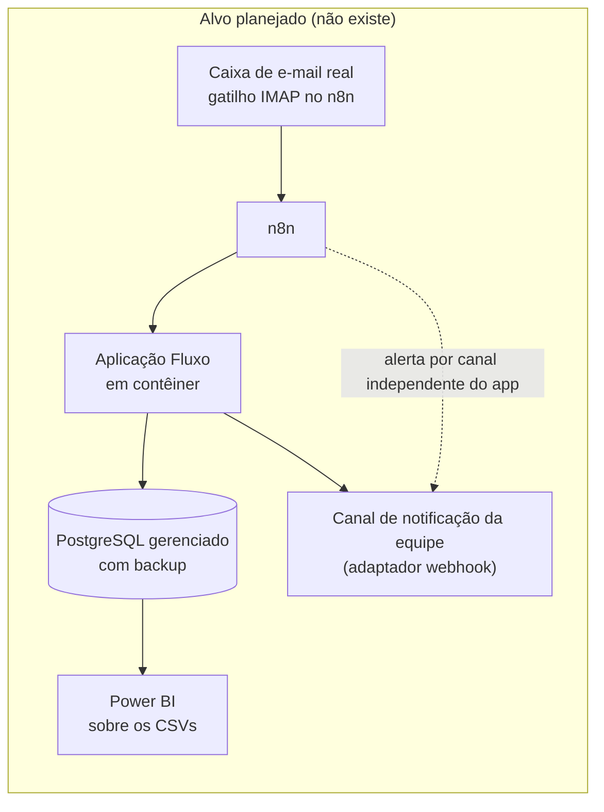

# 8 · Implantação e operação

← [Ciclo de vida](README.md) · [Índice](../INDEX.md) · Anterior: [Testes e qualidade](07-testes-e-qualidade.md) · Próximo: [Evolução e roadmap](09-evolucao-e-roadmap.md)

O Fluxo nunca foi implantado em ambiente de operação. Esta página separa o que existe e foi executado do que é plano para uma implantação futura. O plano é artefato do cenário; não há evidência de implantação.

## O que existe e foi executado

| Item | Situação | Evidência |
|---|---|---|
| Banco PostgreSQL e n8n por Docker Compose | Executado localmente | [Resultados de testes](../05-qualidade/01-resultados-de-testes.md) |
| Aplicação Next.js construída e servida (`npm run build`, `npm run start`) | Executado localmente | [Log do build](../05-qualidade/execucao-build-09f1d18.txt), E2E |
| Perfil `app` do Compose (aplicação em contêiner, `Dockerfile` em Node 22) | Definido, não executado | RNF-07, parcial |
| Fluxo do n8n com retentativa e alerta | Executado em 3 cenários | [n8n](../04-processo/n8n-como-rodar.md) |
| Endpoint de saúde `GET /api/health` | Implementado e usado pelo Playwright para esperar o app | `playwright.config.ts` |
| Painel, tela de notificações e trilha de auditoria | Implementados | [Galeria](../screenshots/README.md) |

## Arquitetura de implantação planejada

Diferenças em relação ao que existe: gatilho IMAP real (hoje, webhook simulado), banco gerenciado com backup, canal de notificação real e alerta de falha fora do app.

## Ambientes e configuração

| Ambiente | Estado | Configuração |
|---|---|---|
| Local de desenvolvimento | Existe | `.env` a partir de `.env.example`; instruções em [CONTRIBUTING.md](../../CONTRIBUTING.md) |
| Homologação | Planejado | Mesma imagem, banco separado, chave de API própria, dados fictícios |
| Operação | Planejado | Segredos fora do repositório; chave de API trocada; `NOTIFIER=webhook` |

Dependências externas: servidor de e-mail (IMAP, a verificar), canal de notificação e, opcionalmente, provedor de LLM. Nenhuma foi exercitada.

## Plano de implantação e rollout (planejado)

| Fase | O que acontece | Critério para avançar |
|---|---|---|
| 1 · Sombra | O Fluxo processa cópia dos e-mails enquanto o lançamento manual continua; as decisões são comparadas | Decisões iguais às da equipe nos pedidos corretos; taxa de revisão conhecida |
| 2 · Piloto | Parte dos clientes passa a ser lançada pelo Fluxo; a equipe trata a fila | Fila sob controle; nenhum pedido perdido; sem duplicata |
| 3 · Operação | Todo o fluxo de e-mail passa pelo Fluxo | Meta de taxa de revisão e de exceção parada definida pela gerência na fase 2 |

A fase 1 produz o dado que falta: a taxa de revisão real, entrada mais frágil da [estimativa de ganho](../04-processo/relatorio-de-medicao.md).

## Plano de rollback (planejado)

1. Desativar o fluxo no n8n: novos e-mails deixam de entrar no Fluxo e voltam ao lançamento manual.
2. Manter os pedidos já registrados, que continuam consultáveis, com a trilha de auditoria.
3. Reconciliar manualmente estoque e crédito reservados pelo Fluxo com os valores do ERP, porque não há integração entre os dois.
4. Reprocessar na fila as exceções em aberto ou lançá-las à mão.

Como o ERP é fechado, o item 3 é o ponto frágil do rollback e está nos riscos abaixo.

## Preparação dos dados

Estoque e crédito entram por seed hoje. A premissa do caso é uma exportação diária de CSV do ERP, mas **a importação desse CSV não está implementada**; seria um item de implantação (ver [roadmap](09-evolucao-e-roadmap.md)).

## Treinamento e adoção (planejado)

| Público | Conteúdo |
|---|---|
| Assistente de vendas | Ler os motivos da fila, corrigir SKU, CNPJ, quantidade e prazo, reprocessar |
| Gerente comercial | Aprovar crédito e alçada com justificativa, ler o painel e a idade da exceção mais antiga |
| Financeiro | Manter o saldo de crédito atualizado na importação diária |

Material de apoio já existente: [galeria de telas](../screenshots/README.md), [regras de negócio](../02-definicao/02-regras-de-negocio.md), [glossário](../GLOSSARIO.md).

## Monitoramento, suporte e indicadores

| Capacidade | Existe hoje | Planejado |
|---|---|---|
| Painel com status, tempo, taxa de revisão, motivos e idade da exceção mais antiga | Sim | — |
| Tela de notificações | Sim (canal simulado) | Canal real |
| Trilha de auditoria por pedido | Sim | Restrição de só inserir no banco |
| Alerta de exceção parada | Não | RF-16, RN-13, HU-14 |
| Logs estruturados e alertas automáticos | Não | Sim |
| Suporte | Não definido | Escala por severidade e canal de chamado |

Indicadores de adoção que o sistema já calcula: pedidos registrados sem passar pela fila, taxa de revisão, duplicatas ignoradas, motivos de exceção, idade da exceção mais antiga e tempo para resolver (`seconds_to_resolve` no CSV de exceções). As metas numéricas ficam para a fase de piloto; este relatório não as inventa.

## Riscos operacionais e continuidade

| Risco | Efeito | Tratamento atual | Lacuna |
|---|---|---|---|
| App fora do ar | Mensagens não são processadas e o alerta também não sai (passa pelo app) | Retentativa no n8n; mensagem persistida antes de processar | Alerta por canal independente |
| Estoque e crédito desatualizados (ERP fechado) | Pedido aceito sem saldo real | Reserva atômica no Fluxo; premissa documentada | Importação diária não implementada |
| Fila de exceções esquecida | Pedido parado | Idade visível no painel | Alerta ativo (v1.1) |
| Perda de dados do banco | Perda de histórico e auditoria | — | Backup e política de retenção não existem |
| Acesso sem autenticação | Qualquer pessoa na rede aprova exceção | — | Autenticação e perfis |

---

**Natureza dos registros.** A tabela "O que existe" é evidência observada; fases de rollout, rollback, treinamento e arquitetura-alvo são artefatos de planejamento do cenário, sem implantação correspondente.
