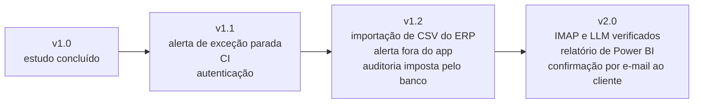

# 9 · Evolução e roadmap

← [Ciclo de vida](README.md) · [Índice](../INDEX.md) · Anterior: [Implantação e operação](08-implantacao-e-operacao.md) · Voltar ao [README](../../README.md)

## Histórico de versões

| Versão | Conteúdo | Situação |
|---|---|---|
| v1.0 | Pipeline, fila de exceções, aprovação, auditoria, n8n, CSV, carga de 500 mensagens | No repositório; `package.json` declara 1.0.0; sem tag nem release |
| v1.1 | Alerta de exceção parada (RF-16, RN-13, HU-14) | Planejada, sem código |

Mudanças do repositório depois dos marcos de implementação estão no [CHANGELOG](../../CHANGELOG.md) e no [histórico de configuração](06-desenvolvimento-e-configuracao.md#histórico-de-mudanças-relevantes).

## Solicitações de mudança e impactos

O registro completo, com o que foi aceito, recusado e adiado, está em [Requisitos e rastreabilidade](03-requisitos-e-rastreabilidade.md#registro-de-mudanças). As mudanças de maior impacto: a alçada de R$ 15.000 (nova RN-07 e HU-07) e a exceção de crédito aprovável (RN-05, RF-09).

## Problemas identificados e ações corretivas

| Problema | Ação | Resultado |
|---|---|---|
| Deadlock sob carga (DEF-01) | Ordem estável de bloqueio e deadlock como falha transitória | Execução final 500 de 500; regressão automatizada |
| Extrator descartava linha com saudação (DEF-02) | Remoção do prefixo de saudação | Regressão automatizada |
| Documentação divergente do código (ADR-003, scripts do `package.json`, alvos da rastreabilidade) | Nota de revisão, remoção de scripts mortos, alvos corrigidos | Links e referências conferidos |
| Imagem do n8n sem versão fixa | `n8nio/n8n:2.44.6` | Documentação e compose coerentes |

Detalhes e causas em [Testes e qualidade](07-testes-e-qualidade.md#registro-de-defeitos-e-achados).

## Dívida técnica

Priorizada por risco ao negócio e custo estimado de correção (P1 maior prioridade). Tudo abaixo está aberto.

| Prioridade | Item | Origem |
|---|---|---|
| P1 | Autenticação de usuário e perfis; hoje a interface e as rotas de leitura, exportação, geração e reprocessamento são abertas e o nome de quem aprova é texto livre | ACH-02 |
| P1 | Workflow de CI com lint, tipos, testes de integração (com PostgreSQL) e build | [Configuração](06-desenvolvimento-e-configuracao.md#cicd-e-automações) |
| P1 | Alerta de exceção parada | RF-16, RN-13, HU-14 |
| P2 | Auditoria que só insere, imposta pelo banco (gatilho ou permissão), e sem exclusão em cascata | ACH-01 |
| P2 | Importação diária de CSV de estoque e crédito | [Implantação](08-implantacao-e-operacao.md#preparação-dos-dados) |
| P2 | Alerta de falha por canal independente do app | [n8n](../04-processo/n8n-como-rodar.md) |
| P2 | Verificar leitura de e-mail real (IMAP) e extração por LLM | [Resultados de testes](../05-qualidade/01-resultados-de-testes.md) |
| P3 | Mais casos adversariais para o extrator | DEF-02 |
| P3 | Auditoria de acessibilidade (axe e leitor de tela) | RNF-08 |
| P3 | Relatório de Power BI sobre os CSVs | [Power BI](../06-pos-lancamento/power-bi.md) |
| P3 | Migrar de `next lint`, que o Next.js avisa que será removido na versão 16 | [Log do lint](../05-qualidade/execucao-lint-09f1d18.txt) |
| P3 | Feriados nos dias úteis; preço por cliente; motivos de exceção em tabela própria | [Regras de negócio](../02-definicao/02-regras-de-negocio.md), [Modelo de dados](05-modelo-de-dados.md) |
| P3 | Medir cobertura de código | [Testes e qualidade](07-testes-e-qualidade.md#cobertura-e-limites-da-estratégia) |

## Roadmap

Proposta de sequência; não há datas, porque o repositório não tem compromisso de entrega.

| Versão | Justificativa |
|---|---|
| v1.1 | Fecha a lacuna que a gerência pediu na reunião 1 (saber o que ficou parado) e dá base de verificação automática |
| v1.2 | Remove as dependências de operação que hoje são manuais (saldo do ERP) e fortalece o controle (auditoria, alerta) |
| v2.0 | Verifica as integrações que hoje só têm teste simulado e entrega ao cliente o que ficou adiado (HU-15) |

## Lições aprendidas

- **Medir sob carga antes de afirmar confiabilidade.** Os testes passavam e a carga de 500 mensagens ainda achou dois defeitos; manter a execução defeituosa no repositório tornou a correção verificável.
- **A correção traz o teste.** Dos dois defeitos, um ganhou teste de regressão no mesmo commit e o de ordem de bloqueio só ganhou o seu depois; o teste de concorrência agora cobre essa lacuna.
- **A documentação precisa de conferência contra o código.** Alvos de teste inexistentes, scripts mortos, versão de imagem diferente da citada e um ADR que descrevia o hash de forma diferente da implementação foram achados ao confrontar texto e código.
- **Separar o simulado do medido.** Tempos do processo atual e ganho são estimativa; carga e testes são execução. Cada número da documentação cita a origem.
- **Corrigir o defeito mostrado, não o resultado.** O teste de concorrência primeiro falhou por um erro do próprio teste (cliente de crédito curto, que a RN-05 corretamente bloqueia); a causa foi corrigida no teste sem relaxar a asserção.

---

**Natureza dos registros.** Histórico, defeitos e correções são evidência observada; prioridades e roadmap são proposta de planejamento do cenário.
