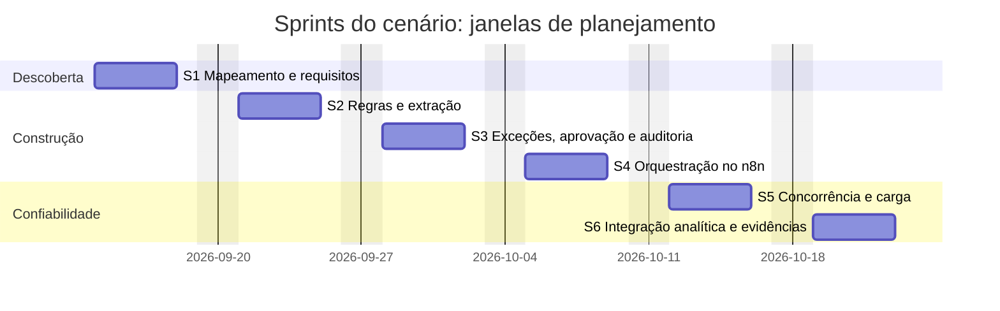
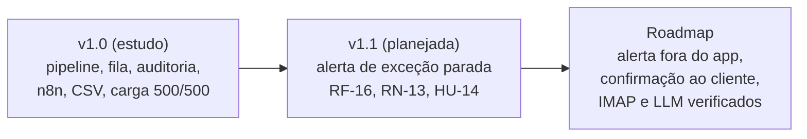

# Ciclo de vida do Fluxo

← [README](../../README.md) · [Índice da documentação](../INDEX.md) · [Glossário](../GLOSSARIO.md)

Este conjunto de documentos percorre o projeto do problema de negócio à evolução prevista: discovery, requisitos, planejamento em Scrum, arquitetura, dados, desenvolvimento, testes, implantação e melhoria contínua. Cada página liga necessidade, requisito, decisão, código, teste e resultado, e aponta para os documentos já existentes em vez de repeti-los.

## Como ler

| # | Documento | Pergunta que responde |
|---|---|---|
| 1 | [Visão e discovery](01-visao-e-discovery.md) | Qual é o problema, para quem e o que fica fora? |
| 2 | [Planejamento e Scrum](02-planejamento-e-scrum.md) | Como o trabalho foi organizado em backlog, releases e sprints? |
| 3 | [Requisitos e rastreabilidade](03-requisitos-e-rastreabilidade.md) | De cada regra de negócio até o teste que a prova |
| 4 | [Arquitetura e ADRs](04-arquitetura-e-adrs.md) | Como o sistema é composto e por que assim? |
| 5 | [Modelo de dados](05-modelo-de-dados.md) | Que dados existem e como o banco protege a consistência? |
| 6 | [Desenvolvimento e configuração](06-desenvolvimento-e-configuracao.md) | Como o código evolui, é versionado e verificado? |
| 7 | [Testes e qualidade](07-testes-e-qualidade.md) | O que foi testado, com que resultado e o que falta? |
| 8 | [Implantação e operação](08-implantacao-e-operacao.md) | Como entrar em operação, monitorar e reverter? |
| 9 | [Evolução e roadmap](09-evolucao-e-roadmap.md) | O que mudou, o que ficou como dívida e o que vem depois? |

Apoio: [reuniões](reunioes/README.md) · [sprints](sprints/README.md) · [catálogo de diagramas](diagramas/README.md).

## Linha do tempo

Duas linhas de tempo convivem e não devem ser confundidas.

**Janelas de planejamento do cenário** (artefato de planejamento do estudo de caso; não são datas de commit):

**Marcos reais do Git** (datas observadas no histórico do repositório):

| Data (commit) | Commit | Marco |
|---|---|---|
| 23/10/2026 13:21 | `bea867c` | Estrutura inicial do repositório |
| 23/10/2026 13:24 | `9b15ba3` | Discovery e definição: RF, RN, HU, atas |
| 23/10/2026 13:37 | `55b7464` | Pipeline, extração, validação, idempotência, ADRs e schema |
| 23/10/2026 13:47 | `2f2ef7b` | Interface, fila de exceções, CSV, medição e correção do deadlock |
| 23/10/2026 13:51 | `d5c832b` | Fluxo n8n, rota de alerta e teste E2E |
| 23/10/2026 16:01 | `dfb83b4` | Teste da rota de alerta; documentos de testes, n8n e Power BI |
| 23/10/2026 16:13 | `7415a84` | README e relatório de medição |
| 24/10/2026 | PR #1 e PR #2 | Apresentação em série, telas reais, logs de execução, README de competência |

O Git mostra a implementação concentrada em 23/10/2026. As seis sprints são a leitura do trabalho em ciclos de entrega coerentes, e cada página de sprint traz a coluna "Registro no Git" com os commits reais. Não há tags nem releases, e o repositório não tem workflow de CI.

## Evolução por versão

---

**Natureza dos registros.** Evidências observadas (código, commits, logs, medições) e artefatos de planejamento do cenário (janelas de sprint, cerimônias, plano de implantação) aparecem nas mesmas páginas. A nota de contexto acadêmico no [README](../../README.md#nota-de-contexto-acadêmico) explica a diferença.
