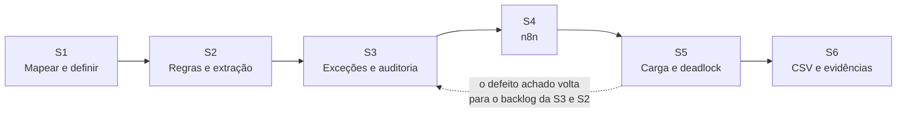

# Sprints

← [Ciclo de vida](../README.md) · [Planejamento e Scrum](../02-planejamento-e-scrum.md)

Seis sprints de uma semana, planejadas para o cenário acadêmico. As janelas são artefato de planejamento; os commits reais estão na coluna "Registro no Git" de cada página e todos caem em 23/10/2026.

| Sprint | Janela do cenário | Objetivo | Página |
|---|---|---|---|
| S1 | 14–18/09/2026 | Entender o processo e fixar o escopo, as regras e os requisitos | [Sprint 1](sprint-1-mapeamento-e-requisitos.md) |
| S2 | 21–25/09/2026 | Pedido bem formatado entra, é validado e registrado sem duplicar | [Sprint 2](sprint-2-regras-e-extracao.md) |
| S3 | 28/09–02/10/2026 | O que dá errado vira exceção explicada, corrigível e auditada | [Sprint 3](sprint-3-excecoes-aprovacao-e-auditoria.md) |
| S4 | 05–09/10/2026 | Receber pelo n8n, com retentativa e alerta de falha | [Sprint 4](sprint-4-orquestracao-n8n.md) |
| S5 | 12–16/10/2026 | Provar o comportamento sob carga e corrigir o que a carga mostrar | [Sprint 5](sprint-5-concorrencia-e-carga.md) |
| S6 | 19–23/10/2026 | Entregar dados para análise e fechar as evidências | [Sprint 6](sprint-6-integracao-analitica-e-evidencias.md) |

## Definition of Ready

- A história tem ator, objetivo e critério de aceite no formato dado/quando/então.
- As regras envolvidas (RN) e os códigos de exceção estão identificados.
- As dependências (dados de seed, outra história) estão resolvidas ou explícitas.

## Definition of Done

Derivada da prática do repositório:

- Código tipado e sem erros no typecheck.
- Testes da história escritos e passando (unitário, integração ou E2E, conforme a camada).
- Documentação atualizada: requisito, regra, rastreabilidade e, quando há decisão, ADR.
- Commit em Conventional Commits, citando os IDs (RF, HU, RN, ADR).

## Indicadores de fluxo

O repositório não tem dados de story points, velocity, lead time nem burndown, e este relatório não apresenta nenhum. O que existe é a contagem de histórias por sprint nas páginas ao lado e a data real dos commits.
