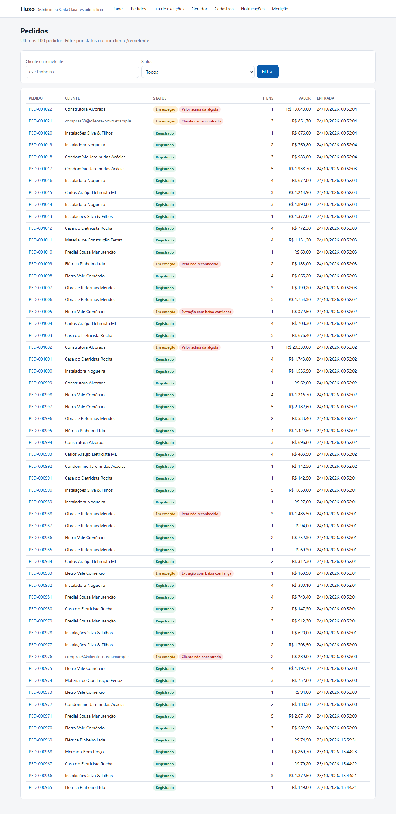
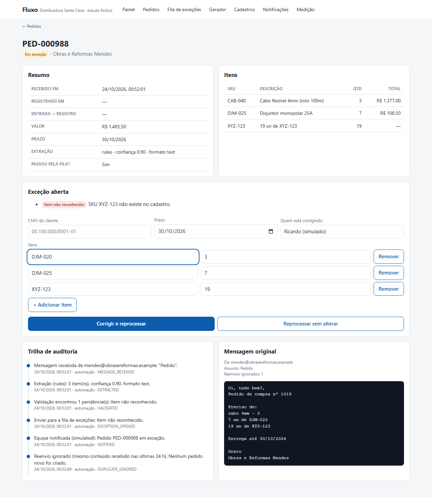
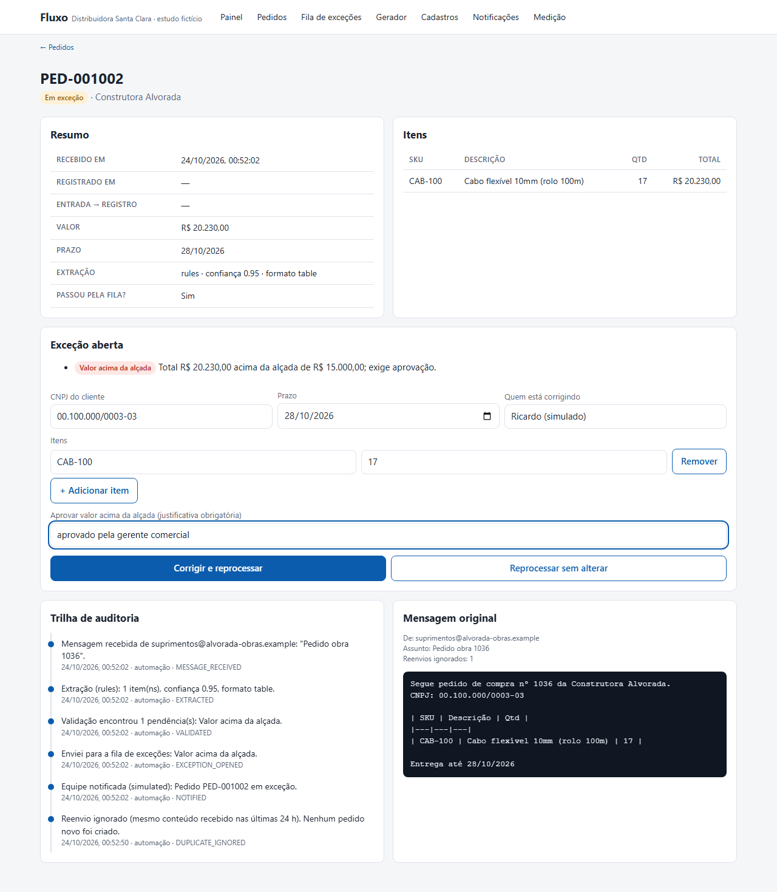
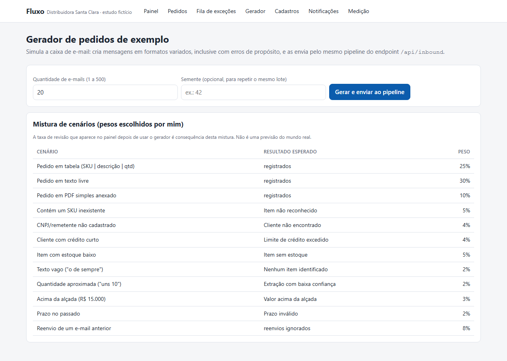
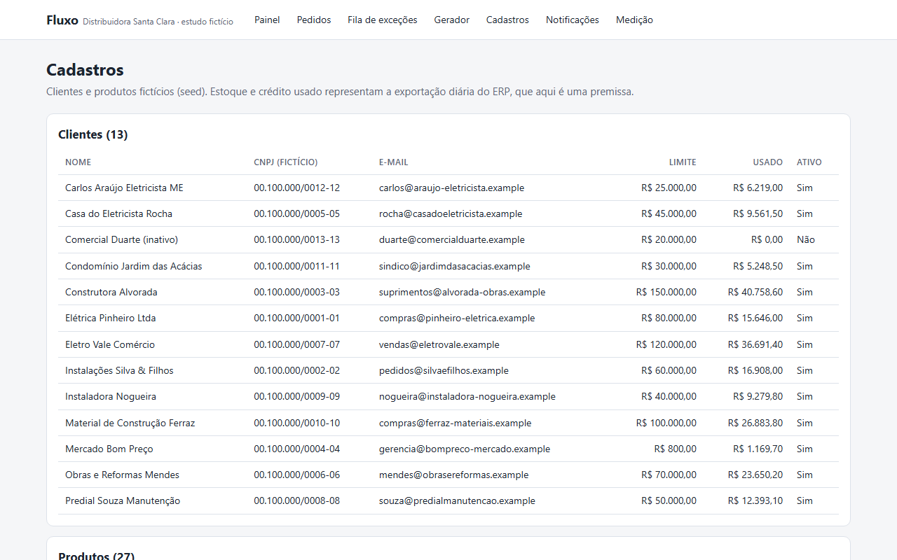
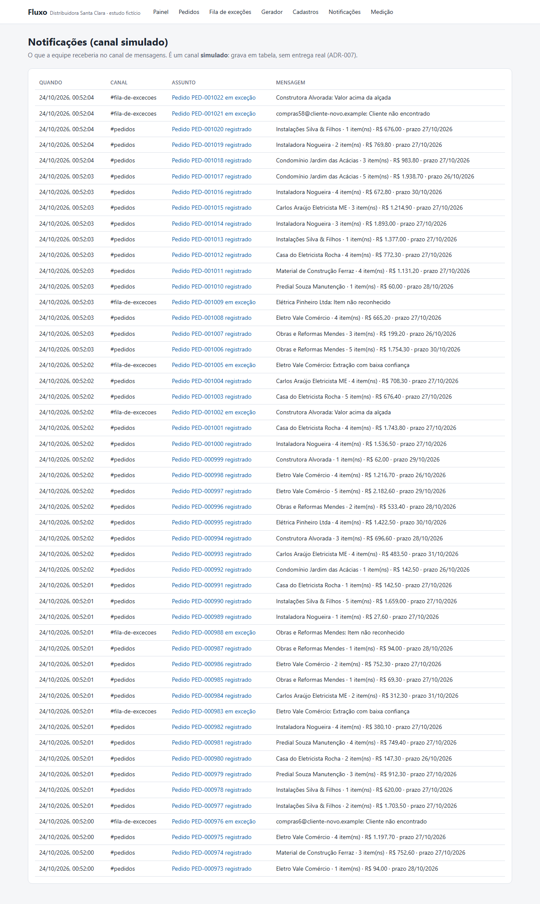
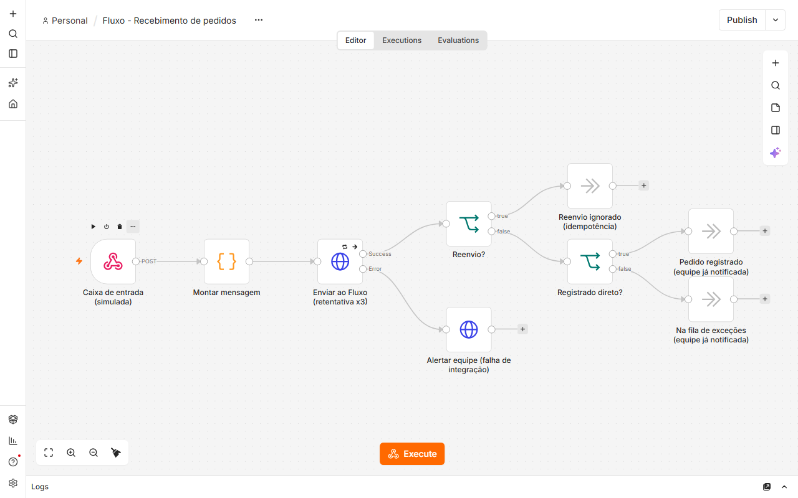

# Galeria de telas

Capturas do app rodando local, em 1280 px de largura, na ordem do fluxo. Os dados são de demonstração, gerados pelo gerador do produto (`/generator`, lote de 60 e-mails, semente 11), sobre o banco local com o cadastro de exemplo. A taxa de revisão do painel vem dessa mistura de cenários.

Para refazer as imagens: `npm run build`, `npm run start` e `npm run screenshots` (script em [`scripts/screenshots.spec.ts`](../../scripts/screenshots.spec.ts)).

Não há captura do Power BI: não existe relatório.

O GIF [`demo-excecao.gif`](demo-excecao.gif) (16 s) mostra um fluxo real: o lote é gerado pelo gerador, um pedido com SKU inexistente cai na fila de exceções, o SKU é corrigido e o pedido é reprocessado e registrado. Gravado com Playwright e convertido com ffmpeg, sem edição.

| # | Tela | O que se vê · por que importa |
|---|---|---|
| 1 | Painel | Seis indicadores (58 pedidos processados, 50 registrados, 8 na fila, taxa de revisão de 17,2%, tempo de entrada até registro com e sem revisão), barras por status e por motivo de exceção e os últimos pedidos. · A HU-08 pede exatamente esses indicadores: status, tempo, taxa de revisão e motivos. |
| 2 | Pedidos | Lista dos pedidos com filtro por cliente ou remetente e por status; os pedidos em exceção mostram o motivo ao lado do status. · O motivo aparece em linguagem de negócio (RNF-08). |
| 3 | Detalhe de pedido com exceção | O pedido PED-000988 com resumo, itens, a pendência "Item não reconhecido" (SKU XYZ-123 fora do cadastro), o formulário de correção, a trilha de auditoria e a mensagem original. · A trilha mostra o que a automação decidiu e por quê (HU-09, ADR-006). |
| 4 | Fila de exceções | Oito exceções abertas com cliente, motivos, valor e tempo parado, e duas resolvidas, com quem corrigiu. · É a interface entre a automação e a pessoa (ADR-005, HU-05). |
| 5 | Correção | O mesmo pedido com o SKU do primeiro item trocado por DJM-020 no formulário, antes de enviar. · Corrigir não pula a validação: o pedido é revalidado e só vira registrado se passar (ADR-005, HU-06). |
| 6 | Aprovação humana | O pedido PED-001002, de R$ 20.230,00, com o campo de justificativa de valor acima da alçada preenchido, antes de enviar. · Acima de R$ 15.000 a aprovação é obrigatória e fica na auditoria (RN-07, HU-07). |
| 7 | Gerador | Formulário de quantidade e semente e a tabela com a mistura de cenários e os pesos. · A taxa de revisão do painel é consequência dessa mistura, não uma previsão (HU-11). |
| 8 | Cadastros | Tabela de clientes fictícios com limite de crédito, valor usado e situação. · Estoque e crédito representam a exportação diária do ERP, que aqui é premissa (RF-13). |
| 9 | Medição | Os resultados da carga de 500 mensagens (500 de 500, 6,4 s, mediana de 95 ms, revisão de 27,5%), os desfechos e a estimativa de ganho com as entradas. · A tela lê o mesmo arquivo do [relatório de medição](../04-processo/relatorio-de-medicao.md). |
| 10 | Notificações | Lista do canal simulado, com os canais `#pedidos` e `#fila-de-excecoes`. · O canal grava em tabela e não prova entrega real (ADR-007). |
| 11 | Canvas do fluxo no n8n | O fluxo "Fluxo - Recebimento de pedidos" no n8n 2.44.6: caixa de entrada simulada, montagem da mensagem, envio ao Fluxo com retentativa x3, os desvios de reenvio, registrado e exceção, e o ramo de alerta em caso de falha. · É a orquestração descrita no [ADR-001](../03-arquitetura/ADRs.md#adr-001--n8n-ou-código-puro) e no [passo a passo do n8n](../04-processo/n8n-como-rodar.md). |

## Imagens

<table>
<tr>
<td></td>
<td></td>
</tr>
<tr>
<td></td>
<td></td>
</tr>
<tr>
<td></td>
<td></td>
</tr>
<tr>
<td></td>
<td></td>
</tr>
<tr>
<td></td>
<td></td>
</tr>
<tr>
<td colspan="2"></td>
</tr>
</table>

